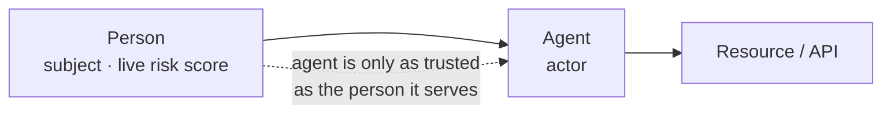
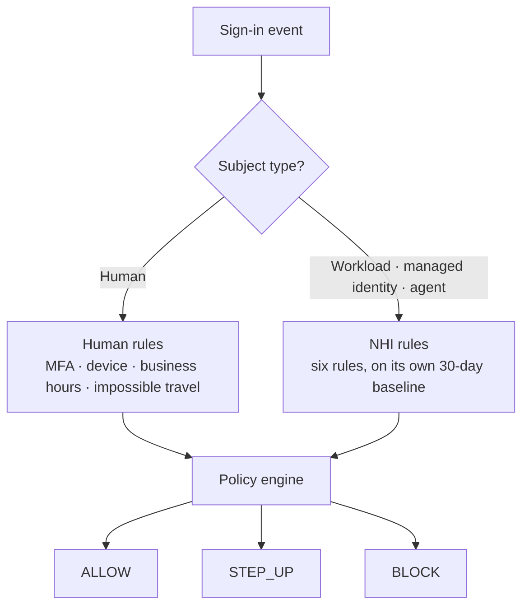

# An Agent Can’t Answer an MFA Prompt

*The rule that protects your administrators would block every automation you run.*

I run a small platform that scores identity risk in Microsoft Entra ID: behavioural signals from sign-in events feed eleven deterministic rules and an anomaly model, and a policy engine returns one answer — allow, step up, or block.

One of the eleven rules is the kind every security team has:

> A privileged role, used without MFA, is blocked.

A good rule for people. Then I fed it sign-ins from service principals, managed identities and AI agents. A workload has no phone; an agent can’t tap “Approve”. Every privileged service principal signs in without MFA, by design — so the human rules would block the backup job, the payroll sync and the deployment pipeline within minutes. The platform had never scored a non-human identity, so the bug had never fired.

## The identities nobody signs in as

Non-human identities (NHIs) — service principals, managed identities, API clients, and now AI agents — already outnumber people in most tenants. They hold standing privileges, often authenticate with secrets that live for years, and nobody is paged when one signs in at 03:00, because that is when they always do.

Agents add something new: an agent often acts **on behalf of a person**, using your rights. If your session is compromised, the agent working for you is now working for the attacker — and controls built around human sessions never see it.

So I extended the platform, starting with four questions every NHI must answer.

## Four questions for every non-human identity

1. **Who is it?** One identity per workload or agent — never shared, never a human account in disguise. A service account three teams share can’t be scored; it has no single “normal”.
2. **How does it prove it?** Preferably without a stored secret — short-lived tokens from a managed identity or federated credential, not a password that lives for years. When an agent acts for a person, that token also names both of them, which makes the delegation visible to the audit log and a risk scorer (below).
3. **Who answers for it?** Every NHI needs an accountable owner, a review date, and access that expires.
4. **Is it behaving like itself right now?** Governance asks “should it have this access?” on a cycle; runtime risk asks “is this sign-in normal?” on every event. This is the question my platform answers.

None of this is vendor-specific — Entra, SailPoint and Okta each answer the first three questions in their own way. One difference bites: I expected Entra’s agent delegation to use RFC 8693 token exchange, as Okta’s Cross App Access does. It doesn’t — Entra uses the **jwt-bearer** grant. If your estate spans both, “the agent acts for the user” is two different protocols, so a risk engine shouldn’t depend on either; it should reconstruct the actor chain from the logs.

## What “behaving like itself” means

People are noisy — they travel, change laptops, work late. Workloads are not: a payroll sync calls the same API, from the same network, with the same credential type, at the same rate, every day. That regularity is the signal, so anything new means more for a workload than for a person.

Each NHI gets a 30-day baseline. Five signals come from its behaviour, three from the identity graph:

| Signal | What it catches |
|---|---|
| New network | A new ASN or IP for a workload that only ever called from one place |
| New resource | A token for an API it has never asked for |
| Credential drift | A **client secret** from an identity whose history is all federation, certificates or managed identity — a classic leaked-secret sign |
| Token velocity | Tokens in the last 15 min vs *this identity’s own* average rate, not a global threshold |
| Delegating person’s risk | The agent inherits the latest risk score of the user it acts for |
| *Governance* | Owner/sponsor count, whether it holds a privileged role, and days since last recertification |

The last signal is why I built this: an agent inherits the live risk score of the person it acts for, so a compromised person can’t launder access through an agent — the agent is only as trusted as its subject:

## Six rules, and the ones that must never run

| Rule | Fires when | Outcome on its own |
|---|---|---|
| Agent acting for a risky user | Delegating user scores 30+ (above 70) | Step up (block) |
| Privileged NHI with no owner | Privileged role, zero owners or sponsors | Step up |
| Secret where federation is the norm | Credential drift | Step up; block if privileged |
| New network or resource | Either is new (both are new) | Adds risk (step up) |
| Token burst | At least 5× its own rate | Up to step up |
| Stale recertification | Never reviewed, or 90+ days ago | Adds risk |

The more important change is what **doesn’t** run. The human rules are now guarded to fire only for people, in both the scorer and the policy, so the administrator-without-MFA rule still blocks while a backup job sails through:

I also kept the anomaly model away from NHIs. Trained on human behaviour, it would call any workload that signs in at 03:00 with no MFA and no device an outlier. NHIs are scored by rules and policy only, until there is enough reviewed data to train a model on them.

## Step up, when nobody can be stepped up

For a person, “step up” means another MFA prompt. An agent can’t answer one, so the enforcement has to mean something else. The decision values stay ALLOW / STEP_UP / BLOCK and the policy engine is still the only place that decides — but it now knows the subject type (human, workload, managed identity or agent) and the actor chain.

| Value | For a person | For an NHI or agent |
|---|---|---|
| STEP_UP | Another MFA prompt | **Sponsor or owner approves**, or scopes narrow to the task; for credential drift, the owner confirms and rotates to a federated credential |
| BLOCK | Deny the sign-in | **Revoke tokens and sessions, disable the service principal** or drop its time-bound grant, page the owner; for a risky delegation, revoke that user’s grant |

A blocked agent should also trigger an off-cycle recertification: a runtime alert is evidence a governance review should have caught something.

## The poller that was itself an NHI

Some irony: the component that reads risk data from Microsoft Graph is itself an NHI that authenticated with a client secret. It now uses its own managed identity — a federated credential, with Terraform creating the trust — and keeps the secret only for local dev, with a warning. Writing about secretless workloads from a service that held one would have been hard to defend.

## Where this stops working

| Limit | What it means |
|---|---|
| Field names unconfirmed | Microsoft documents the agent-type marker and a dedicated sign-in event, but I couldn’t confirm the exact property path on exported records. The mapping is isolated and flagged — verify against a real tenant. |
| Governance data must exist | Owners, sponsors and recertification dates come from your governance tool. Without them, those rules stay silent by design — an unknown is a data gap, not a missed review. |
| No NHI model yet | Rules catch what I thought of; the rest needs an anomaly model trained on non-human data and analyst verdicts. |
| Tested, not deployed | 188 unit tests and 18 policy tests pass, infra validates. The policy tests surfaced two older bugs — overlapping rules returned an error, and reason text never reached the output. End-to-end proof still needs a real tenant. |

Treat an agent as an identity: give it an owner, a review date and expiring access, and score it against its own baseline and the trust of the person it acts for. The vendors cover who the agent is and what it may hold; the gap I wanted to close is whether it is still behaving like itself.

Which non-human identities in your tenant would you not be able to name an owner for today? [Tell me on LinkedIn](https://linkedin.com/in/anandkn2012).
