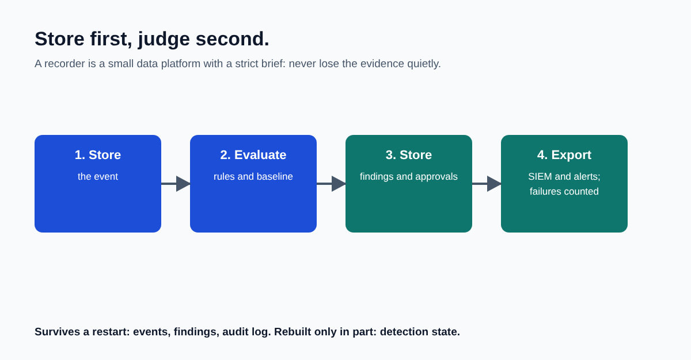

A flight recorder for AI agents is a small data platform with a strict brief: it holds evidence.

A dashboard that loses a row is a nuisance. A recorder that loses a row has a gap in the evidence.

So the data decisions in Agent Sentinel are the ones I'd ask about on any regulated platform:

Store first, judge second. The event is saved before any rule runs. If detection has a bug, the record of what the agent did is already kept.

Keep less. A 256-character preview and the true size, not the payload. Secrets are removed before the preview is cut, not after.

A backend must not pretend. The laptop database can't keep an audit trail. It used to return success anyway. Now it refuses and names the fix.

The same event twice changes nothing. Collectors retry.

And the part I'd raise first in a review: what survives a restart. The events do. Part of the detection state doesn't, and the article says which part.

What's the first question your platform team asks about a new data store?

First comment: Read the full article → https://anandnarayanan.net/blog/agent-sentinel-07-the-data-platform-under-the-recorder/
Code and tests: https://github.com/anandnarayanan2017/anandnarayanan-blog/tree/main/agent-sentinel

#AIAgents #DataEngineering #DataPlatform #Observability
