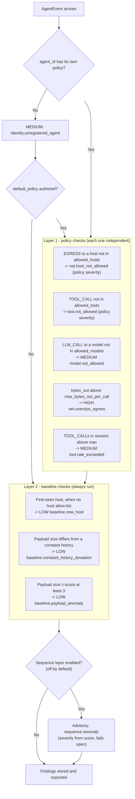

# Part 3 — Rules First, Statistics Second

<!--
DRAFT, not published. Publishes on the date for "3" in ../../series.json
(2026-11-30). On that day, from the repository root:
`python agent-sentinel/scripts/publish_part.py 3`, then build, PR, merge.
The code, tests and evaluation docs this part links to are already in the
public folder. `examples/phase2/sequence_eval_payments_demo.py` reproduces
every figure below (checked 2026-11-20). Line counts in "Where the AI
actually is" were recounted on 2026-11-20; recount if the code changes.
-->

> **Reader path:** [LinkedIn post](../linkedin/03-rules-first-statistics-second.md) → this article → [design and implementation](#design-and-implementation) → [code-and-test traceability](../../TRACEABILITY.md#publication-traceability)

## A wire transfer before the identity check

A KYC agent's sessions normally run the same way: verify the customer's
identity, check the sanctions list, write a case note. One session runs
differently: verify the identity, check the sanctions list, initiate a wire
transfer.

Every one of those steps might be on the agent's approved list. A rulebook
that checks one step at a time has nothing to object to. A person reading the
timeline would see the problem in seconds: the order is wrong.

That gap is what this part is about. So is a choice I made before writing any
detection code: who gets the final say when a person, a rule and a model
disagree.

## Where the AI actually is

The question an AI-security product should answer first, with counted numbers
rather than positioning.

**Agent Sentinel performs no AI model inference of its own.** It wraps the
Anthropic and Azure OpenAI SDKs, but only to record the calls an *agent*
makes. Agent Sentinel never asks a model anything itself.

| Layer | Lines | Share | What it is |
|---|---:|---:|---|
| Platform: API, storage, sign-in, collectors, export | 2,949 | 54% | Plumbing |
| Sequence model, with its tooling and synthetic test data | 1,790 | 33% | The only machine learning |
| Policy rules, event schema, explanations | 618 | 11% | `if` statements and string templates |
| Descriptive statistics (`detection/baseline.py`) | 104 | 2% | Means, standard deviations, set membership |

*Non-blank lines of Python, tests excluded, in the public code folder once all
five parts are published.*

Two-thirds of the product contains no AI or machine learning at all. Most of
the remaining third is tooling around one small model: test-data generators,
evaluation, a model registry and drift checks. The model itself is under 200
lines. It is a Markov chain: it counts, for each agent role, which step tends
to follow which, smooths the counts so a step it has never seen is
*surprising* rather than *impossible*, and saves the result as a file of
numbers. There is no neural network, no gradient and no machine-learning
library anywhere in the code.

## Rules decide

Each agent has a policy written in plain YAML: the hosts it may contact, the
tools it may run, the models it may call, how much data it may send in one
call and how many tool calls a session may make. Every event is checked
against that policy, and anything outside it becomes a finding that names the
rule, the agent and the evidence.

In [Part 1](../../technical-details/01-why-agents-need-a-flight-recorder.md)
I compared two answers to a compliance officer's "why was this flagged?":
"the model scored it 0.87" against "it called a tool its policy doesn't allow;
here is the clause". Only the second can be checked, challenged and changed by
a person in a pull request.

[ADR-0001](../../../adr/0001-rules-first-detection.md) makes that ordering
structural rather than a matter of habit. The rules run first. They are the
only layer whose findings cite a policy clause. And when blocking exists, they
will be the only layer allowed to block.

## Statistics advise, and only about order

The one thing a list of rules can't see is order. An allow-list can confirm
that verifying an identity, checking sanctions and initiating a wire transfer
are each permitted. It can't notice that, for this role, a wire transfer has
no business coming straight after a sanctions check.

That is where the sequence model earns its place. It learns how each agent
role normally moves from step to step, then scores new sessions by how
surprising their steps are. A flagged session comes with the same kind of
evidence as a rule finding. Not "87% anomalous", but:

> step 4: after verify identity → check sanctions list, expected *write case
> note* (p=0.71) or *flag for review* (p=0.22); observed *initiate wire
> transfer* (p=0.003).

Three things keep it in its place:

- **It ships switched off.** You turn it on per deployment, deliberately.
- **It can't cite a policy clause.** The code that builds its findings sets
  the clause to nothing, so it has no grounds to block anything.
- **It fails open.** If it can't load or crashes, the rules carry on without
  it.

## The first metric was wrong

My first version scored a session by its *average* surprise per step. It
looked reasonable and turned out to be the wrong measure. A few malicious
steps inside an otherwise normal ten-step session barely move an average: on
the first test role, the order-1 model missed every privilege-escalation
session.

Scoring by the three *most* surprising steps instead fixed it. Same model,
different arithmetic: the F1 score went from 0.85 to 0.99.

## Where it still struggles

That first role was small, so I built a harder one: a payments bot with twice
the actions, eight normal workflows and seven attack patterns injected one or
two at a time.

Every session with two attack patterns injected together was caught. The gap
is in small, single injections. Two or three extra steps hidden in a long,
otherwise normal session are diluted again, one level up: a burst of extra
outbound network calls on its own was caught in none of the sessions, and an
unauthorised override in one in six.

On this harder role the fix from the previous section didn't hold either.
Scoring by the plain average did slightly better than scoring by the three
most surprising steps (F1 0.90 against 0.87). The configuration I kept is
not the best on every test; it is the one I can explain and calibrate.

**Small, quiet attacks in long sessions are the hardest thing for this layer
to catch.** That is exactly why it advises and never decides.

One caveat, stated because the code states it: I wrote both the normal
workflows and the attacks. These are stress tests on synthetic data, not
real-world performance figures.

## The trade-off

Rules first has a real cost. Someone has to write and maintain a policy for
every agent, and behaviour the policy doesn't describe goes unflagged by the
rules. The sequence model covers a slice of that, as a second opinion rather
than an authority.

And everything here still happens after the fact. A finding helps you
investigate the wire transfer; it doesn't stop it.

Next: [Part 4 — The Enterprise Foundation](04-enterprise-foundation.md).

Where have you seen a clever score hide the thing that actually mattered?
[Tell me on LinkedIn](https://linkedin.com/in/anandkn2012).

## Design and implementation

Agent Sentinel is rules-first by design. A black-box model should not be the primary judge of whether another model-powered agent is allowed to move money, call a tool, or exfiltrate data.

### Policy decision tree

Each event runs through every layer. The checks are independent, so one event
can produce several findings (an unapproved host *and* an oversize transfer,
for example), and no check stops the event.



Severities in brackets are the defaults; a policy can override them with
`severity_overrides`. `TOOL_REQUESTED` events (a model proposing a tool it has
not run) are recorded but only a `TOOL_CALL` is checked against
`allowed_tools`.

```python
findings = engine.evaluate(event)
for finding in findings:
    store.insert_finding(finding)
```

The important design choice: **the engine never parses raw HTTP**. It only understands the normalized schema.

| Layer | Owns |
|---|---|
| Collector | Capturing traffic from SDK, proxy, APIM, or future eBPF |
| Parser | Turning provider-specific traffic into `AgentEvent` |
| Engine | Evaluating policy and baseline rules |
| Explainer | Turning rule outcomes into audit-friendly findings |
| Storage | Persisting events, findings, approvals, and audit trail |

### When rules aren't enough: teaching Sentinel what normal looks like

Rules-first is what a fintech auditor can actually read and trust. But a policy engine checks each event against a static envelope, one call at a time — it cannot see that step 3 came before step 2, or that a normally-idle agent just made fifteen calls in a row, or that this session's *shape* looks nothing like every other session this role has ever run. Those are sequence properties, and sequences need a different kind of model.

`sentinel_sequence` is that model: an order-1/2 Markov chain over each agent role's normal action sequences, scored against new sessions by how surprising they are.

```text
AgentEvents -> split_sessions -> Tokenizer -> MarkovModel -> score_session -> evidence chain
   (DuckDB)     (gap or          (frozen        (order 1/2,     (mean NLL +      ("expected {A,B},
                 session_id)      vocab, UNK)    smoothed)       top-k surprise)   observed C")
```

Every event becomes a token (`tool:verify_id`, `llm:call`, `net:egress_new_domain`). The model learns, per role, which tokens follow which — then scores a new session by how unlikely its transitions are under that learned distribution.

#### The dilution problem

The first version scored sessions by mean surprise per step (mean negative log-likelihood). It looked reasonable in isolation and turned out to be the wrong metric: a handful of injected malicious steps, diluted across an otherwise-normal ten-step session, barely move an average.

| Model / score | Precision | Recall | F1 |
|---|---|---|---|
| order-1, mean NLL | 1.000 | 0.740 | 0.851 |
| order-2, mean NLL | 0.978 | 0.880 | 0.926 |
| order-1, top-3 surprise | 0.980 | 1.000 | 0.990 |
| **order-2, top-3 surprise** | **0.980** | **1.000** | **0.990** |

*`kyc_bot_demo`, synthetic data: the normal workflows and the attacks were both
written by the author, so these are not real-world performance figures (see
[`docs/PHASE2.md`](../../../PHASE2.md)).*

Mean-NLL missed every privilege-escalation session at order 1 and about half
of them (48%) at order 2. Scoring by the mean of the *k* most surprising steps
(top-k surprise) stops concentrated anomalies being outvoted by the normal
steps around them.

#### Fusion contract — advisory only

`sentinel_sequence` never gets to say no. It sits alongside the Phase 1 statistical baseline as a second advisory signal:

| Layer | Blocks the action today? | Role |
|---|---|---|
| YAML policy engine | No | Deterministic, compliance-relevant findings |
| Statistical baseline | No | Windowed feature anomalies -> severity signal |
| Sequence model | No | Behavioral-sequence anomalies -> severity signal + evidence chain |

“Allowed” and “not allowed” describe policy conformance. `Engine.evaluate()`
returns `Finding` objects after an observed event; it is not a pre-action policy
decision point.

Every flagged session comes with the same evidence-chain discipline as a policy finding — not "87% anomalous," but "step 4: after [verify_id -> check_sanctions_list], expected {write_case_note (p=0.71), flag_for_review (p=0.22)}; observed initiate_wire_transfer (p=0.003)."

#### What's real today

Built and tested in this folder: the tokenizer, order-1/2 Markov scoring, a
versioned per-role model registry with atomic publish and integrity
checksums, and drift detection (a median-surprise ratio, so a role whose
prompt or toolset changes legitimately triggers "model stale, retrain"
instead of an alert storm). Code review found and closed real bugs on the
way, including a SQL-injection surface in the DuckDB column-mapping config
and a time-of-check/time-of-use gap in model-checksum verification. The
tests are in [`test_sentinel_sequence.py`](../../../../app/tests/test_sentinel_sequence.py),
[`test_sequence_layer.py`](../../../../app/tests/test_sequence_layer.py) and
[`test_seq_adapter.py`](../../../../app/tests/test_seq_adapter.py). The layer
is wired into `detection/engine.py` alongside the policy and baseline layers
as an optional, advisory-only third layer (`SENTINEL_SEQ_ENABLED`, off by
default).

#### Stress-testing on a second, harder role

`kyc_bot_demo` has 12 actions across 4 templates and 4 fixed attack functions — small enough that near-perfect recall doesn't tell you much about where the model's limits are. `payments_bot_demo` ([`app/sentinel_sequence/data_gen_payments.py`](../../../../app/sentinel_sequence/data_gen_payments.py)) doubles the vocabulary to 25 actions across 8 templates, and replaces fixed attack *functions* with a library of 7 attack *primitives* composed 1-2 at a time at randomized injection points — 24 distinct observed attack-label combinations in a 100-session eval, not 4.

| Model / score | Precision | Recall | F1 |
|---|---|---|---|
| order-1, mean NLL | 0.976 | 0.830 | 0.897 |
| order-1, top-3 surprise | 0.972 | 0.700 | 0.814 |
| order-2, mean NLL | 0.974 | 0.740 | 0.841 |
| **order-2, top-3 surprise** | **0.987** | **0.770** | **0.865** |

Bold marks the configuration the pipeline uses. On this harder role, order-1 mean-NLL actually scores a higher F1 (0.897 vs 0.865): top-3 surprise did not win here, which is part of why the numbers are reported as a stress test rather than a result.

Lower than `kyc_bot_demo`'s numbers — and *why* is the actual finding. Every multi-primitive attack (two primitives injected together) scores **1.000 recall**, 17/17 combinations perfectly caught. The gap is entirely in small, single-primitive injections:

| Single primitive alone | Recall |
|---|---|
| `exfiltration_burst` (3-6 extra net-egress events) | **0.000** |
| `unauthorized_override` (2 extra events) | **0.167** |
| `limit_bypass` (3 extra events) | **0.500** |
| `order_abuse` (whole-session reorder, no extra length) | 0.875 |
| `burst_loop`, `credential_probe`, `silent_cancel_replay` alone | 1.000 |

A 2-3 event injection inside an otherwise-normal 9-14 event session dilutes the same way mean-NLL diluted across a whole session — top-k surprise has its own dilution floor one level up, once sessions get long enough and injections small enough relative to session length. That's a real, useful limit surfaced by a harder eval, not a number to bury: **small, quiet attacks are the hardest thing for this layer to catch**, which is exactly why it's advisory-only, fused with policy and baseline rather than trusted alone.

This role was also the first to run all the way through the real `app.sentinel.detection.engine.Engine` — not just the standalone `sentinel_sequence` scorer — proving the L3 wiring end to end:

```text
rule_id=sequence.anomaly severity=MEDIUM
  title="Sequence behavior anomaly for role 'payments_bot_demo'"
  explanation: session behavior deviates from learned payments_bot_demo
    baseline (surprise 4.95 > threshold 4.37, model v0001)
  evidence: seq_step_0=step 9: after [tool:cancel_payment], expected
    {tool:write_case_note (p=0.70), tool:close_case (p=0.08),
    llm:call (p=0.04)}; observed tool:verify_2fa (p=0.0064)
```

Same honesty discipline as everywhere else in this repo: this is still self-authored synthetic data ([`docs/EVAL_PAYMENTS_BOT.md`](../../../EVAL_PAYMENTS_BOT.md) carries the full caveat), so it's a robustness stress-test and an integration proof, not a real-world performance claim. What it proves is narrower and more useful than a bigger F1 number would be — *where* the current approach is strong and *where* it isn't, on a case that was deliberately built to be harder than the first one.
