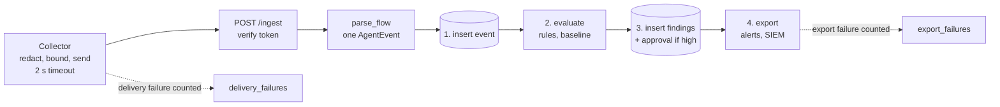

# Part 7 — The Data Platform Under the Recorder

<!--
DRAFT, not published. Season 2, Part 7. It was published on 2026-11-24 and
moved back to drafts the same day. Publish it again, after Part 6, with
`python agent-sentinel/scripts/publish_part.py 7`, which dates it, moves it
and the LinkedIn post out of drafts/, links it from Part 6 and adds its rows
to TRACEABILITY.md and the README. Before publishing:

1. Re-run app/tests/test_storage_contract.py and app/tests/test_audit_chain.py,
   which pin the storage claims, and scripts/docker_e2e.sh for PostgreSQL.
2. After publishing, relink "as Part 7 explains" in Part 6's Boundaries
   section, and point the Part 7 link in the Part 8 draft at
   ../../technical-details/.
-->

> **Reader path:** [LinkedIn post](../../linkedin/07-the-data-platform-under-the-recorder.md) → this article → [design and implementation](#design-and-implementation) → [code-and-test traceability](../../TRACEABILITY.md#publication-traceability)

## A recorder is a small data platform with a strict brief

The earlier parts were about what Agent Sentinel decides. This one is about
where the data goes: how an agent's action becomes a row, which rows are kept,
and what happens to them when something fails.

Most of my career has been data and platform work, and the same questions
come up here that come up on any regulated data platform. What is the record
of truth? What do we refuse to store? What survives a restart? What happens
when the same message arrives twice?

A flight recorder has one extra constraint. It holds evidence. A dashboard
that loses a row is a nuisance. A recorder that loses a row has a gap in the
evidence, so every shortcut has to be a visible one.

## One event shape

Every collector, whatever it watches, produces the same record: an
`AgentEvent`. It has who (agent and session), what (one of five action
types: model call, tool requested, tool call, network call, data access),
where (host, method, path) and how much (bytes out and in). Anything specific
to one provider goes into a free-form attributes field.

Detection, storage and export only ever see this shape. Adding a new model
provider is one parser function. Nothing downstream changes.

## Store first, judge second

When an event arrives, Agent Sentinel does four things, in this order:

1. Store the event.
2. Evaluate it against the rules.
3. Store any findings.
4. Export the findings to alerts and the SIEM.

The order is the design. If a rule has a bug and step 2 fails, the record of
what the agent did is already saved. If the SIEM is down at step 4, the
finding is already saved and the failed export is counted. The thing least
likely to fail goes first, and each later step can fail without losing what
came before.

The cost: ingestion is one synchronous request. There is no queue between
the collector and the database. A burst of traffic meets the database
directly, and a collector that cannot deliver within two seconds gives up,
counts the failure and lets the agent carry on. That is the right choice for
the agent and a real limit for the recorder.

## Small on purpose

The cheapest data to protect is data you never stored. Agent Sentinel keeps a
preview of each payload, not the payload:

- A request body becomes a 256-character preview. Its true size is kept as a
  number, so the oversize rule still works on a 50 KB body.
- Secrets and identifiers are removed **before** the preview is cut. Cut
  first and you can slice a card number in half, leaving a piece the redactor
  no longer recognises.
- The SDK collectors bound what they send in the first place, and send the
  real size separately.

Redaction is best effort and the code says so: it removes keys, tokens, card
numbers, IBANs and email addresses, and it does not understand a customer's
name written in a sentence.

## Two databases, one interface

On a laptop, events and findings go into DuckDB: one file, no server,
SQL an analyst can query. Set a connection string and the same code writes to
PostgreSQL, with events and the audit log as time-partitioned tables when the
TimescaleDB extension is there, and as ordinary tables when it is not.

Two details mattered more than the choice of engine.

**A backend must not pretend.** DuckDB keeps no audit trail and no
approvals. An early version accepted those calls and returned success while
storing nothing. A reviewer saw an empty audit log that looked exactly like
"no activity". Now a backend that cannot record a decision refuses it and
names the fix.

**Lock only what needs it.** The detection state in memory is shared between
requests, so it is always locked. Storage is locked only on the backend that
needs it. DuckDB uses one connection and must take turns. PostgreSQL has a
connection pool and does not, so its writes run in parallel.

## The same event, twice

Collectors retry. Networks deliver twice. Each event carries its own ID, and
storing the same ID again changes nothing. On PostgreSQL a high-severity
finding opens exactly one approval, however many times it is written.

Without this, a retry would turn one transfer into two rows and, worse, two
items in a reviewer's queue.

## What survives a restart, and what doesn't

This is the part I would raise first in a design review.

Events, findings, the audit log and approvals are in the database. They
survive.

The detection state is in memory, and it is rebuilt only in part:

- **Known hosts are rebuilt.** On first use after a restart, each agent's
  list of hosts it has contacted is read back from stored events.
- **Payload-size history is not.** The baseline that notices an unusually
  large payload starts empty and needs five new observations before it says
  anything.
- **Per-session tool counts are not.** A session's tool budget starts again
  from zero.

The same applies across processes: two server processes each hold their own
counts. For the rules that read a policy clause (hosts, tools, models, size
per call) none of this matters. They need no history. It matters for the
statistics and for the tool budget, and it is why Agent Sentinel runs as a
single server today.

## What a platform team would ask next

Not built, and worth saying plainly:

- **Retention.** No rule deletes or archives old events. Retention periods
  are a legal decision the operator has to make and apply in the database.
- **A queue.** Ingestion straight over HTTP, as above.
- **Team separation.** No tenant or environment column.
- **Schema versions.** New columns are added at start-up; there is no
  versioned migration history.
- **Tamper evidence for events.** The hash chain protects the API audit log,
  not the events and findings themselves.

## One more kind of agent to record

Every agent in this series so far has done business work: reconciling payments,
checking identities. The agents writing software are agents too. My companion
series, [AI-assisted SDLC](https://anandnarayanan.net/blog/ai-assisted-sdlc-01-from-arm-assembly-to-ai/),
runs a coding agent inside a harness that keeps its own record: a transcript of
every model call, one commit per attempt, the output of every check.

That record is kept by the system it describes, the same weakness
[Part 2](../../technical-details/02-from-simulated-traffic-to-real-model-calls.md)
accepted for the SDK wrappers. Point the coding agent's model calls at
Agent Sentinel and nothing on this page changes: the same `AgentEvent`, the same
store-first path, a policy saying which models the generator may call and which
hosts it may reach. The harness keeps its evidence; the recorder keeps a second
copy that the harness cannot edit. The other series asks whether we can trust
what the agent built. This one asks whether we can trust what it did. For a
coding agent, the two questions meet in one record.

## The trade-off

A synchronous path with one database is easy to reason about: an event is
either stored or counted as lost, and there is no third place for it to be.
That simplicity is what makes the evidence easy to trust, and it is also the
throughput ceiling. A queue would raise the ceiling and add a place where
events can wait, reorder or expire. For a pilot I chose the path I can
explain in one sentence.

What is the first question your platform team asks about a new data store?
[Tell me on LinkedIn](https://linkedin.com/in/anandkn2012).

## Design and implementation

### The ingest path

The whole path is [`Pipeline.ingest_event`](../../../../app/sentinel/pipeline.py):
store lock, insert, engine lock, evaluate, store lock, insert findings, then
the two export calls outside any lock.

### Where each claim lives

| Claim | Code | Proof |
|---|---|---|
| One event shape, five action types | [`schema/events.py`](../../../../app/sentinel/schema/events.py), [`collector/parsers.py`](../../../../app/sentinel/collector/parsers.py) | [`test_pipeline.py`](../../../../app/tests/test_pipeline.py) parser tests |
| The event is stored before it is evaluated | `Pipeline.ingest_event` | `test_event_is_stored_before_it_is_evaluated` in [`test_storage_contract.py`](../../../../app/tests/test_storage_contract.py) |
| A failed export is counted and does not stop ingestion | `_fire_alerter`, `_push_siem` in `pipeline.py` | [`test_export.py`](../../../../app/tests/test_export.py) |
| A failed delivery is counted and does not stop the agent | [`collector/sdk_base.py`](../../../../app/sentinel/collector/sdk_base.py) | `test_delivery_failures_are_counted_not_only_logged` in [`test_collector_contracts.py`](../../../../app/tests/test_collector_contracts.py) |
| 256-character preview, true size kept | `parsers._preview`, `parse_flow(request_bytes=...)` | `test_evidence_preview_is_bounded_and_the_real_size_is_kept` |
| Redact, then cut | [`collector/redaction.py`](../../../../app/sentinel/collector/redaction.py) | `test_redaction_runs_before_truncation` in [`test_redaction.py`](../../../../app/tests/test_redaction.py) |
| Long prompts keep their model and real size | `sdk_base.bound_request` | `test_long_prompt_keeps_model_and_real_size_so_rules_still_fire` |
| A backend that cannot record a decision refuses it | [`storage/base.py`](../../../../app/sentinel/storage/base.py) | `test_duckdb_store_really_raises_rather_than_no_op` and the 501 tests in [`test_api_main.py`](../../../../app/tests/test_api_main.py) |
| DuckDB reads do not interfere with each other | `Store._query` in [`storage/store.py`](../../../../app/sentinel/storage/store.py) | [`test_store_concurrency.py`](../../../../app/tests/test_store_concurrency.py) |
| Storage is locked only where the backend needs it | `StoreBase.thread_safe`, `Pipeline.__init__` | Read from the code; no dedicated test |
| A re-sent event does not duplicate | `INSERT OR REPLACE` (DuckDB), `ON CONFLICT DO NOTHING` (PostgreSQL) | `test_resending_the_same_event_does_not_duplicate_it` (DuckDB) |
| One approval per finding | `ux_approvals_finding_id` in [`storage/pg_store.py`](../../../../app/sentinel/storage/pg_store.py) | Read from the code; exercised by `scripts/docker_e2e.sh` |
| Known hosts are rebuilt after a restart | `BaselineStore.get` in [`detection/baseline.py`](../../../../app/sentinel/detection/baseline.py) | `test_known_hosts_are_rebuilt_from_the_store_after_a_restart` |
| Payload history is not rebuilt | `AgentBaseline.bytes_out_samples` | `test_payload_history_is_not_rebuilt_after_a_restart` |
| The audit chain detects edits, deletions and reordering | [`storage/audit_chain.py`](../../../../app/sentinel/storage/audit_chain.py) | [`test_audit_chain.py`](../../../../app/tests/test_audit_chain.py) |

### The tables

| Table | Key | Backend | Notes |
|---|---|---|---|
| `events` | `event_id` (with `ts` on PostgreSQL) | Both | 14 columns; `attributes` and `evidence` as JSON. Time-partitioned by `ts` when TimescaleDB is present |
| `findings` | `finding_id` | Both | Rule, clause, explanation, event IDs, evidence, control references |
| `audit_log` | `audit_id`, `ts` | PostgreSQL | One row per protected API request, with `prev_hash` and `entry_hash` |
| `audit_chain` | single row | PostgreSQL | The chain head, locked for each audit write so two writers cannot fork the chain |
| `approvals` | `approval_id` | PostgreSQL | One per high or critical finding |

Indexes follow the two questions a reviewer asks: "what did this agent do
recently" (`agent_id, ts DESC` on events and findings) and "what is serious"
(`severity, ts DESC` on findings).

The Docker stack in this folder runs plain PostgreSQL 16, so it shows the
fallback path: the same tables, without time partitioning.

### Two limits of the audit chain, now tested

Writing the chain tests for this part made two limits concrete:

- Cutting the newest entries off the log leaves a shorter chain that still
  verifies. Only the stored chain head, or a copy kept outside the database,
  shows that entries are missing.
- Someone who can rewrite every later row can rebuild a valid chain.

Both are in `test_audit_chain.py` as tests that pass today, and both are why
anchoring the chain head outside the database is on the roadmap in Part 4.

Next: Part 8 — From a Finding to a DORA Obligation.
