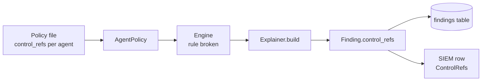

# Part 8 — From a Finding to a DORA Obligation

<!--
DRAFT, not published and not scheduled. Parts 1-5 are the planned series;
this is a follow-up part. Before publishing:

1. VERIFY EVERY REGULATORY REFERENCE AGAINST THE OFFICIAL TEXT. The article
   numbers, titles and paraphrases below were written from memory and checked
   only against secondary summaries: EUR-Lex was not reachable when this was
   drafted. Open each link under "Sources" and confirm the article number,
   its title and that the paraphrase is fair. Nothing here is quoted verbatim
   on purpose.
2. Confirm the CSSF circular position with current CSSF guidance. This draft
   only repeats the scope note already in ../../TRACEABILITY.md.
3. Decide whether to tidy the control_refs labels in policies/fintech.yaml
   (see "Labels worth tidying" at the end) before or with this part.
4. Add a date for "8" to ../../series.json, add the "sources" for "8" (the
   list at the end), move this file and the LinkedIn post out of drafts/.
5. Add the hero image at ../../images/08-from-a-finding-to-a-dora-obligation-1.png
   and the image line to the LinkedIn post. The site build needs it.
6. Add the Part 8 row from ../traceability-rows.json to ../../TRACEABILITY.md.
7. The alerting and Log Analytics code is copied in when Part 4 is published;
   link the Article 10 row to it then.
-->

> **Reader path:** [LinkedIn post](../linkedin/08-from-a-finding-to-a-dora-obligation.md) → this article → [design and implementation](#design-and-implementation) → [code-and-test traceability](../../TRACEABILITY.md#publication-traceability)

## "Is it DORA compliant?" is the wrong question for a tool

I get asked this about most platforms I design. The honest answer is always
the same: a tool is not compliant. A financial entity is, or is not, and it
shows that with policies, processes, people and evidence. A tool can supply
some of the evidence.

So the useful question is narrower. For one specific obligation: what does
this tool produce, how do I know it works, and what is still mine to do?

Every finding in this series has carried a line of control references, such
as "DORA Art.10 (anomaly detection)". I have called them navigation aids and
left it there. This part does the work properly: obligation by obligation,
with the code, the test, and the part that stays with the firm.

I am an architect, not a lawyer. This is how I read these texts when I design
a system. It is not legal advice, and whether an article applies to you
depends on what kind of entity you are and what the agent does.

## How a control reference gets onto a finding

The person who writes an agent's policy lists the controls that policy
supports. When the agent breaks a rule, the finding carries that list, and so
does the row exported to the SIEM.

So a control reference is the policy author's claim: "this rule helps with
that obligation". The software copies it faithfully. It does not check that
the claim is right.

## The mapping

Each row paraphrases the obligation. The links to the official texts are at
the end.

### DORA Article 10: detection

*The obligation, in short:* have mechanisms to detect anomalous activities
promptly, with more than one layer of control, defined alert thresholds, and
alerts that reach the people who handle incidents.

*What Agent Sentinel provides:* two detection layers for agent activity.
Rules written per agent decide. A statistical baseline adds lower-severity
context. Each rule has a severity, the policy can change it per agent, and
severity decides what is alerted and what waits for a reviewer.

*How I know:* the rule tests in Part 1, and the ten prompt-injection outcomes
in [Part 6](06-prompt-injection-what-the-recorder-catches.md), including the
ones that raise nothing.

*What stays with the firm:* everything that is not an instrumented agent.
Choosing the thresholds. Staffing the people the alerts go to. And Part 6's
lesson: activity inside the policy is not detected.

### DORA Article 9: protection and prevention

*The obligation, in short:* protect ICT systems and data, including limiting
access to what is needed and using strong authentication.

*What Agent Sentinel provides:* this one needs care, because there are two
different things to protect.

For **the recorder itself**: every API call needs a token from the firm's
identity provider, a missing configuration means every request is refused,
and sending events, reading findings, approving and reading the audit log
are separate permissions.

For **the agents**: a written record, per agent, of the hosts, tools and
models it is meant to use, and a finding when it goes outside that. Agent
Sentinel does not prevent anything. It tells you that prevention elsewhere
did not hold.

*How I know:* the authentication and role-separation tests from Part 4.

*What stays with the firm:* the actual access controls on the agents: network
rules, tool permissions, credentials. The policy file describes the intended
access. It does not enforce it.

### DORA Article 17: the incident management process

*The obligation, in short:* run a process to detect, manage and record
ICT-related incidents, with early warning indicators, assigned roles, and
root causes found and addressed.

*What Agent Sentinel provides:* an early warning with its evidence attached,
and, on PostgreSQL, a review record for each high-severity finding: approved,
escalated or suppressed, with a comment, by a reviewer identified from their
sign-in.

*How I know:* the approval tests from Part 4, including the one that proves a
caller cannot name someone else as the reviewer.

*What stays with the firm:* the process. A finding is not an incident. A
person decides that, and "escalated" in Agent Sentinel is a status, not a
ticket in your incident system.

### DORA Articles 18 and 19: classification and reporting

*The obligation, in short:* classify incidents against set criteria (such as
clients affected, duration, data loss, criticality of the service) and report
major ones to the authority.

*What Agent Sentinel provides:* nothing, and this is where the mapping is
most often overstated. A finding's severity is a label attached to a rule. It
says how seriously to treat a broken rule. It knows nothing about how many
clients were affected or for how long.

*What stays with the firm:* all of it. The evidence in a finding can feed the
classification. It is not the classification.

### DORA Article 11: response and recovery

*The obligation, in short:* have a business continuity policy and response
and recovery plans, and be able to act on them.

*What Agent Sentinel provides:* an input. It does not contain, stop or
recover anything.

The example policy in this series cites Article 11. Having written this row,
I think that reference is the weakest one in the file. I would keep it only
on policies whose findings are wired into a response plan.

### DORA Article 28: ICT third-party risk

*The obligation, in short:* manage the risk from ICT third-party providers,
including keeping a register of the contractual arrangements.

*What Agent Sentinel provides:* a model provider is an ICT third party. Each
agent's policy names the models and hosts it may use, every model call is
recorded with its provider, and a call to an unapproved model is a finding.
That is a record of **actual use**, which can be compared with the register.

*How I know:* `test_unapproved_model_flagged` in the Part 1 tests.

*What stays with the firm:* the register, the contracts, the exit plans, the
concentration analysis. A list of hosts is not a register.

### The technical standard on logging

DORA's detail on logging sits in the Commission's delegated regulation on ICT
risk management, in its article on logging.

*The obligation, in short:* log the events that matter, protect the logs
against tampering, deletion and unauthorised access, and detect when logging
itself fails.

*What Agent Sentinel provides:*

- A record of agent actions, in one shape, with agent, session and time.
- Access to that record only through the role-separated API.
- A hash chain over the API audit log, with a verify call that names the
  first broken entry.
- Counters for telemetry that could not be delivered and findings that could
  not be exported. A recorder that fails quietly is the failure this
  obligation is about.

*How I know:* the audit-chain tests and the storage tests written for
[Part 7](07-the-data-platform-under-the-recorder.md), and the delivery-failure
test from Part 2.

*What stays with the firm:* retention periods, since nothing in Agent
Sentinel deletes or archives. Time synchronisation. Database access. And the
limit from Part 7: the chain covers the audit log, not the events themselves,
and it needs an anchor outside the database to detect a full rewrite.

### EU AI Act Articles 12 and 26: logs

*The obligation, in short:* a high-risk AI system must be able to record
events automatically, and whoever deploys one must keep the logs under their
control for a minimum period.

*What Agent Sentinel provides:* a record kept by the deployer, outside the AI
system, of what the agent called and sent.

*What stays with the firm:* first, deciding whether the agent is a high-risk
system at all. Most internal agents will not be. Second, the system's own
logging, which is the provider's obligation and which an outside recorder
does not replace. Third, retention again.

### EU AI Act Article 14: human oversight

*The obligation, in short:* a high-risk AI system must be designed so people
can oversee it while it is in use, including being able to intervene or stop
it.

*What Agent Sentinel provides:* a named human reviewing serious findings.
That review happens after the action. Agent Sentinel cannot intervene or
stop anything, so this supports oversight and is not the oversight the
article describes.

### CSSF circulars

For Luxembourg entities, DORA changed which parts of the CSSF's ICT circulars
apply to whom. I am not mapping at paragraph level here. The control
references in this series say "as amended; confirm entity scope" for that
reason, and the scope note and link are in the
[traceability matrix](../../TRACEABILITY.md#regulatory-scope).

## Three places the mapping is weaker than it looks

1. **Severity is not incident classification.** Covered above. It is the
   easiest mistake to make with a tool like this.
2. **The hash chain protects the audit log, not the evidence.** It shows who
   read or changed things through the API. Events and findings rely on the
   database's own protection.
3. **A full timeline is not proof of full coverage.** Agent Sentinel records
   what its collectors see. An agent action no collector saw leaves no trace,
   and the record looks just as complete.

## What I would hand an auditor

Not a compliance badge. Four things:

1. The policy file for the agent, with its review history.
2. One finding, showing the rule, the clause and the evidence.
3. The result of the audit-log verify call.
4. The names of the tests behind each claim, and this list of what is not
   covered.

## The trade-off

This mapping is less impressive than a table with a tick in every cell. Three
rows say "partly", and one says "nothing". I think that is what makes the
other rows believable. An assessor who finds one overstated claim stops
trusting the rest.

Which obligation is hardest to evidence for your AI agents today? [Tell me on
LinkedIn](https://linkedin.com/in/anandkn2012).

## Design and implementation

### How a control reference travels

The list is free text. [`AgentPolicy.control_refs`](../../../../app/sentinel/detection/policy.py)
is a list of strings, [`Engine._policy_checks`](../../../../app/sentinel/detection/engine.py)
passes it unchanged to [`Explainer.build`](../../../../app/sentinel/explain/explainer.py),
and it is stored on the [`Finding`](../../../../app/sentinel/schema/events.py).
Nothing validates it against a list of real controls. The one place the code
chooses references itself is `IDENTITY_CONTROL_REFS` in `engine.py`, used when
an agent has no policy entry and no default policy exists.

Baseline findings carry the agent's references too, although no clause was
broken. Read those as "this agent's policy supports these controls", not
"this anomaly breaches them".

### The mapping, with its proof

| Obligation | What exists in this folder | Proof | Coverage |
|---|---|---|---|
| DORA Art. 10, detection | [`detection/engine.py`](../../../../app/sentinel/detection/engine.py), [`detection/baseline.py`](../../../../app/sentinel/detection/baseline.py), [`detection/policy.py`](../../../../app/sentinel/detection/policy.py) (`severity_for`) | [`test_pipeline.py`](../../../../app/tests/test_pipeline.py), [`test_prompt_injection.py`](../../../../app/tests/test_prompt_injection.py) | Partly: instrumented agents only, and only outside the policy |
| DORA Art. 9, access to the recorder | [`api/auth.py`](../../../../app/sentinel/api/auth.py) | [`test_auth.py`](../../../../app/tests/test_auth.py), role tests in [`test_api_main.py`](../../../../app/tests/test_api_main.py) | Yes, for the recorder's own API |
| DORA Art. 9, access by the agents | [`policies/fintech.yaml`](../../../../policies/fintech.yaml) | `test_pipeline.py` | Detection of a breach only; no prevention |
| DORA Art. 17, incident process | Approvals in [`storage/pg_store.py`](../../../../app/sentinel/storage/pg_store.py), `/approvals` in [`api/main.py`](../../../../app/sentinel/api/main.py) | `test_review_approval_uses_verified_principal_not_client_reviewer` and neighbours | Partly: a review record, not a process |
| DORA Art. 18 and 19 | Nothing | | None |
| DORA Art. 11 | Nothing | | None; findings are an input |
| DORA Art. 28, third parties | `allowed_models`, `allowed_hosts`, the `provider` attribute set in [`collector/parsers.py`](../../../../app/sentinel/collector/parsers.py) | `test_unapproved_model_flagged`, `test_parse_llm_call` | Partly: record of use, not a register |
| Logging standard: record | [`schema/events.py`](../../../../app/sentinel/schema/events.py), [`storage/`](../../../../app/sentinel/storage/base.py) | [`test_storage_contract.py`](../../../../app/tests/test_storage_contract.py) | Partly: what collectors see |
| Logging standard: protect the logs | [`storage/audit_chain.py`](../../../../app/sentinel/storage/audit_chain.py), `api/auth.py` | [`test_audit_chain.py`](../../../../app/tests/test_audit_chain.py) | Partly: audit log only; no outside anchor |
| Logging standard: detect logging failures | `delivery_failures` in [`collector/sdk_base.py`](../../../../app/sentinel/collector/sdk_base.py), `export_failures` in [`pipeline.py`](../../../../app/sentinel/pipeline.py), audit write failures in [`api/audit.py`](../../../../app/sentinel/api/audit.py) | `test_delivery_failures_are_counted_not_only_logged`, [`test_export.py`](../../../../app/tests/test_export.py), `test_audit_write_failure_increments_counter` | Yes, as counters; alerting on them is the operator's |
| EU AI Act Art. 12 and 26, logs | Same as "record" above | Same | Partly: an outside record; no retention setting |
| EU AI Act Art. 14, oversight | Approvals | Same as Art. 17 | Partly: review after the action |

### Labels worth tidying

Writing this part showed that the reference labels in the example policies
are looser than the mapping above:

- `"DORA Art.9 (ICT risk mgmt)"` in `fintech.yaml`. Article 9 is protection
  and prevention; the risk management framework is Article 6. The engine's
  own `IDENTITY_CONTROL_REFS` already uses the right title.
- `"DORA Art.11 (response & recovery)"` on the reconciliation agent, as
  discussed above.
- `"EU AI Act Art.15 (accuracy)"` on the payments agent. Nothing in Agent
  Sentinel measures a model's accuracy.

They are free text, so nothing breaks. But the label is what an analyst sees
in the SIEM, and a wrong label there is exactly the kind of overstated claim
this part argues against.

### Sources

- [DORA: Regulation (EU) 2022/2554](https://eur-lex.europa.eu/eli/reg/2022/2554/oj/eng), Articles 9, 10, 11, 17, 18, 19 and 28
- [Commission Delegated Regulation (EU) 2024/1774](https://eur-lex.europa.eu/eli/reg_del/2024/1774/oj/eng), the ICT risk management technical standards, article on logging
- [EU AI Act: Regulation (EU) 2024/1689](https://eur-lex.europa.eu/eli/reg/2024/1689/oj/eng), Articles 12, 14 and 26
- [CSSF update on DORA overlap and Circulars 20/750, 22/806 and 25/882](https://www.cssf.lu/en/2025/04/updates-of-several-cssf-circulars-related-to-ict-risk-management-and-use-of-ict-third-parties-ict-outsourcing/)
