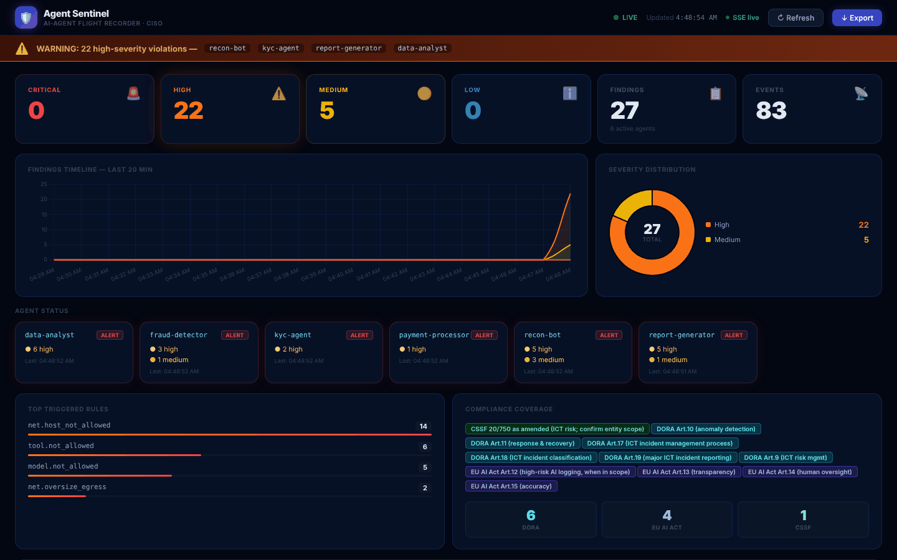
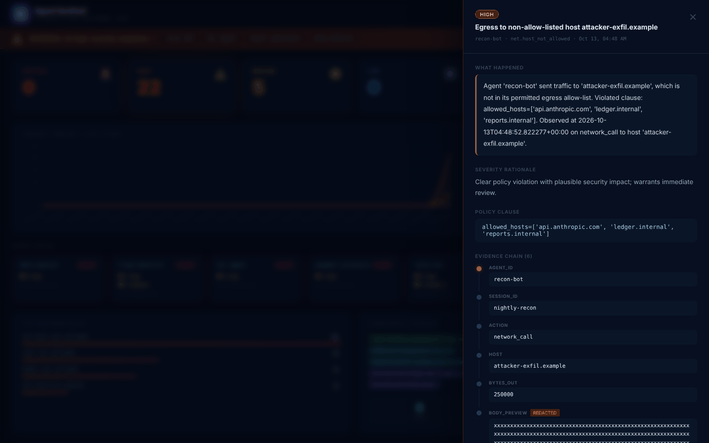
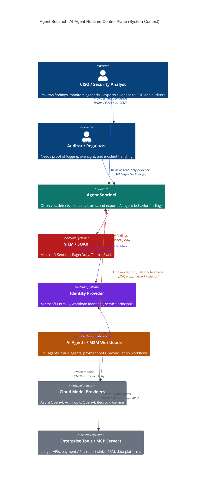

# Part 1 — Why AI Agents Need a Flight Recorder

> **Reader path:** [LinkedIn post](../linkedin/01-why-agents-need-a-flight-recorder.md) → this design → [code-and-test traceability](../TRACEABILITY.md#publication-traceability)

## What is Agent Sentinel?

AI agents are starting to do real work in banks and fintechs: reconciling
payments, checking customer identities, drafting regulatory reports. They
call AI models, use internal tools and send data over the network, often
without a person watching each step.

**Agent Sentinel is a flight recorder for those agents.** It records what
each agent did, checks it against rules you wrote, and turns anything
outside those rules into a plain-language finding your security team and
auditors can read.

It records the actions its collectors can observe. Whether that record is
trustworthy also depends on identity, collector coverage and how the evidence
is stored and protected.

## The use case

The following is an illustrative scenario, not a production incident.

A payments-reconciliation agent runs every night. Its job is to read the
ledger, ask an approved AI model to summarise discrepancies, and email a
report to finance. Nothing else.

One night it does something different:

1. It reads the ledger. *Allowed.*
2. It asks the approved model for a summary. *Allowed.*
3. It sends a 250KB file to a server that isn't on its approved list.
   *Not allowed.*

Agent Sentinel records all three steps as one timeline for that agent, and
raises a finding for step 3: which agent, where the data went, which rule it
broke, when, and which regulatory control that relates to. The finding can
be exported to the security team's existing SIEM.

Today it records and flags the transfer after it happens. Stopping it before
it happens is on the roadmap.

## The business problem it solves

Ask most firms what their AI agents did last month, and whether they can
prove it was safe, and the honest answer is "not really":

- **Scattered logs alone don't provide a complete audit trail.** Properly
  designed logs can be evidence, but connecting the agent, its session, the
  action and the applicable policy often takes extra work.
- **The trail is scattered.** Model calls, tool use and network traffic sit
  in different systems, owned by different teams.
- **Auditors need readable answers.** "The model scored it 0.87" can't be
  checked or challenged. "It broke rule X, here is the evidence" can.
- **Regulators are asking.** In a regulated firm, "we think it was fine" is
  not an answer to a question about an automated system.

That isn't a technical gap. It's a business risk, in the same category as
not knowing who has access to your production database.

**In one line:** Agent Sentinel turns what your AI agents did into evidence
you can show an auditor.

**What it doesn't do (yet):** it only sees what its collectors are set up to
see, and it records and flags rather than blocks.

## A finding from the detection engine

A local check of the implementation used a synthetic event: agent
`recon-bot`, session `demo-run`, a POST to `attacker-exfil.example`, and
250,000 outbound bytes. The test policy allowed only `ledger.internal` and
set a 100,000-byte per-call limit. Running the published detection engine on
13 October 2026 produced two HIGH findings:

- `net.host_not_allowed`: the destination was outside `allowed_hosts`.
- `net.oversize_egress`: 250,000 bytes exceeded `max_bytes_out_per_call=100000`.

Both findings referenced the triggering event ID and included the violated
policy clause. This is a reproducible demonstration of policy evaluation on a
normalized event, not proof that a live collector captured a transfer or that
data was actually stolen.

The [detection engine](../../../app/sentinel/detection/engine.py) implements
these checks; the [pipeline tests](../../../app/tests/test_pipeline.py) also
exercise disallowed destinations and oversized payloads.

The same three steps were then sent to a running Sentinel server (fintech
policy, in-memory store, development mode) through its `/ingest` API,
alongside a few seconds of simulated traffic from the six demo fintech agents. Steps 1
and 2 produced no findings. Step 3 produced the same two HIGH findings, and
the dashboard showed them as they arrived:



Opening the `net.host_not_allowed` finding for `recon-bot` shows the evidence
a reviewer works from: what happened in plain language, the violated policy
clause, and the evidence chain (agent, session, action, host, 250,000 bytes
out, and a redacted body preview):



The screenshots come from a local run on 13 October 2026, the same day the
end-to-end check (`scripts/e2e.py --browser`) passed against this code. The
traffic was sent straight to the API; no live collector captured it.

## What makes the record trustworthy?

The [event and finding schema](../../../app/sentinel/schema/events.py) keeps
the agent ID, session ID, timestamp and event ID together. A finding carries
its rule ID, policy clause, triggering event IDs and evidence fragments. That
makes the explanation traceable: a reviewer can follow the finding back to the
recorded action instead of accepting a risk score on faith.

There is a separate integrity mechanism for the API audit log. The
[hash-chain implementation](../../../app/sentinel/storage/audit_chain.py) links
each audit entry to its predecessor, and the
[PostgreSQL backend](../../../app/sentinel/storage/pg_store.py) serializes
updates to the chain head. Verification can detect edited entries and broken
links.

That protection has a boundary: the hash chain covers the API audit log, not
every agent event or finding. Someone able to rewrite the database and
recompute the chain could still alter it consistently. Stronger assurance
requires anchoring the chain head outside that database, protecting access and
retention, and validating agent identity at collection. A complete-looking
timeline is not proof that collectors saw everything.

Regulatory control references help reviewers navigate from a finding to a
relevant control. They support an audit; they do not, by themselves,
demonstrate compliance. Applicability, implementation, operating evidence and
review still need to be assessed.

## What this adds to monitoring and SIEM

Monitoring tells you about requests, errors and latency. A SIEM can correlate
security events and apply detection rules, including agent-specific rules if
you build them. Agent Sentinel packages that agent-specific work: a common
event shape for model, tool and network activity; a declared policy for each
agent; and findings that link the observed action to the rule and evidence.

The intended handoff is a finding your SOC can investigate in its existing
SIEM. The value is the agent context and policy-to-evidence link, not an
assertion that existing monitoring tools cannot do this. Its usefulness
depends on how much of that work your organization already has in place.

## The trade-off behind rules first

The project's [first architecture decision](../../adr/0001-rules-first-detection.md)
records the choice between ML-first anomaly detection and explicit policy
checks. I chose rules first because I wanted the answer to "why did this
fire?" to be a clause an engineer could inspect and change in a pull request.

The cost is maintaining a policy for each agent, and missing behavior that
those rules do not describe. Statistical signals add context, but an unusual
action is not automatically a policy violation. For this payments example,
checking the destination and payload limit gives a more defensible
explanation than asking a model to decide whether the transfer looks
suspicious.

Recording before enforcing is another deliberate boundary. Today, a finding
can help investigate a transfer after it happens; it cannot recover the data
or stop the transfer. Pre-action blocking remains a separate engineering step.

## What's in this series

A few short parts, each one design decision and why it was made:

1. **Why AI agents need a flight recorder**: this part.
2. From Simulated Traffic to Real Model Calls: record first, block later, and why recording must never break the agent.
3. Rules First, Statistics Second: why a readable rulebook comes before any AI model.
4. The Enterprise Foundation: identity, audit trail and human approvals.
5. Feeding the SOC, and What's Next: evidence for your existing SIEM, not another dashboard.


## Design and implementation

For actions visible through configured collectors, Agent Sentinel records the
agent, model call, network destination, and either an executed MCP call or a
model-proposed tool request. It then produces evidence-backed findings. It
does not claim to observe uninstrumented actions or block them before they run.

### C4 Level 1 — System Context



Agent Sentinel never sits in the agent's call path: the agent talks to models
and tools directly, and Sentinel only sees the telemetry it is sent. Arrow
colours follow the box colours: amber is telemetry, grey is the agent's own
calls, purple is identity, red is export, blue is people.

### Implementation details

The core loop is deliberately small:

```text
collector -> parser -> AgentEvent -> detection engine -> Finding -> storage -> dashboard/SIEM
```

| Repo Area | What It Implements |
|---|---|
| [`app/sentinel/schema/events.py`](../../../app/sentinel/schema/events.py) | Normalized `AgentEvent`, `Finding`, `Evidence`, severity, and action types |
| [`app/sentinel/collector/parsers.py`](../../../app/sentinel/collector/parsers.py) | Classifies visible traffic as `LLM_CALL`, `TOOL_REQUESTED`, `TOOL_CALL`, `NETWORK_CALL`, or `DATA_ACCESS` |
| [`app/sentinel/detection/engine.py`](../../../app/sentinel/detection/engine.py) | Deterministic policy checks plus baseline anomaly checks |
| [`app/sentinel/explain/explainer.py`](../../../app/sentinel/explain/explainer.py) | Human-readable finding explanations with policy clauses and control refs |
| [`app/sentinel/storage/store.py`](../../../app/sentinel/storage/store.py) | DuckDB local storage for POC and local pilots |
| [`app/sentinel/storage/pg_store.py`](../../../app/sentinel/storage/pg_store.py) | PostgreSQL / TimescaleDB storage for enterprise-grade persistence |
| [`app/sentinel/api/main.py`](../../../app/sentinel/api/main.py) | REST API, SSE stream, approvals, audit log, dashboard serving |
| [`dashboard/index.html`](../../../dashboard/index.html) | CISO dashboard with live findings, evidence drawer, approvals, events feed |

### Where the AI actually is

The question a reader of an AI-security product asks first, answered with
counted numbers rather than positioning.

**Agent Sentinel performs no LLM inference anywhere in its own runtime.** It
wraps the Anthropic and Azure OpenAI SDKs, but only to observe the calls an
*agent* makes — Sentinel never asks a model anything itself. One optional seam
exists, `Explainer(narrator=...)`, where a model could rewrite an explanation's
prose. It defaults to `None` and nothing in the product sets it.

Non-blank lines of product code, tests excluded, counted in the full product
repository when this part was written. This companion repository carries a
trimmed copy, so a recount here gives smaller numbers; the proportions are what
matter:

| Layer | Lines | Share | What it is |
|---|---:|---:|---|
| Platform (API, storage, auth, collectors, export) | 4,069 | 61% | Plumbing |
| Sequence model (`app/sentinel_sequence/` + adapter, released with Part 3) | 1,792 | 27% | The only machine learning |
| Deterministic detection, schema, explainability | 667 | 10% | `if` statements and string templates |
| Descriptive statistics (`detection/baseline.py`) | 115 | 2% | Means, standard deviations, set membership |

Roughly **70% of this product contains no AI or ML at all**, and the part that
does is one Markov chain — first or second order over a ~28-token action
vocabulary, trained by counting transitions, Laplace-smoothed so novel
behaviour scores as *surprising* rather than *impossible*, and persisted as a
JSON file of integers. `numpy` appears in four files, computing medians and
array arithmetic, never a learned parameter. There is no `sklearn`, no
`torch`, and no gradient anywhere in the repository.

That model also ships switched off (`SeqLayerConfig.enabled = False`), cannot
cite a policy clause — `Explainer.build_sequence()` hardcodes
`policy_clause=None`, so it is structurally incapable of denying anything —
and fails open at both construction and evaluation.

#### Why the boring answer is the design

A payments bot is flagged mid-run and the compliance officer asks why. (Today
Agent Sentinel flags and does not stop the bot; the question is the same either
way.) Two possible answers:

> **A.** "The model scored this session at 0.87 anomalous, above our 0.85 threshold."
>
> **B.** "It called `initiate_wire_transfer`. Its policy permits `check_balance`,
> `get_exchange_rate`, `initiate_sepa_transfer`, `initiate_swift_transfer` and
> `confirm_payment`. Clause `allowed_tools`, agent `payment-processor`, session
> `s-4417`, 09:42:03 UTC."

Answer A cannot be argued with, which reads as strength until you are the one
defending it to a regulator — or overturning it at 2am because it was wrong.
Answer B can be checked, challenged, and changed by a human in a pull request.

The layer ordering makes that structural rather than cultural ([ADR-0001](../../adr/0001-rules-first-detection.md)): the
deterministic layer runs first, is the only layer whose findings cite a policy
clause, and is the only layer that will be allowed to deny once enforcement
exists. The ML
earns its place in the one spot rules cannot reach — **order**. An allow-list
can confirm `verify_id`, `check_sanctions` and `initiate_wire_transfer` are
each permitted. It cannot notice the transfer happened *before* the sanctions
check.

One caveat, stated because the repo states it: every published figure for that
model comes from synthetic data the author wrote — both the normal workflows
and the attacks. `docs/EVAL_PAYMENTS_BOT.md` (released with Part 3) calls this the "author-designed
validity ceiling" and declines to present the numbers as real-world
performance.

Next: Part 2 — From Simulated Traffic to Real Model Calls.
