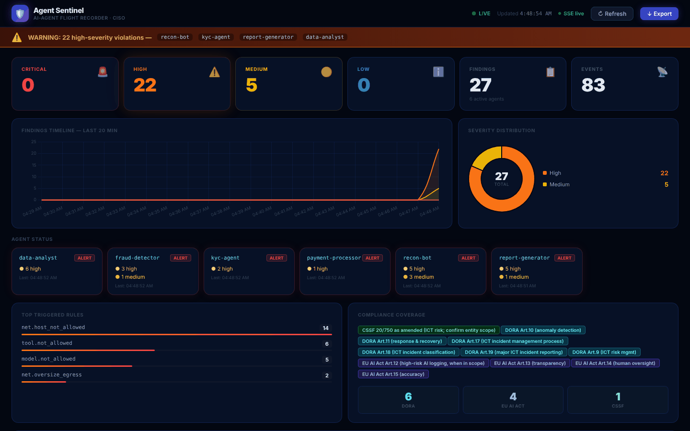
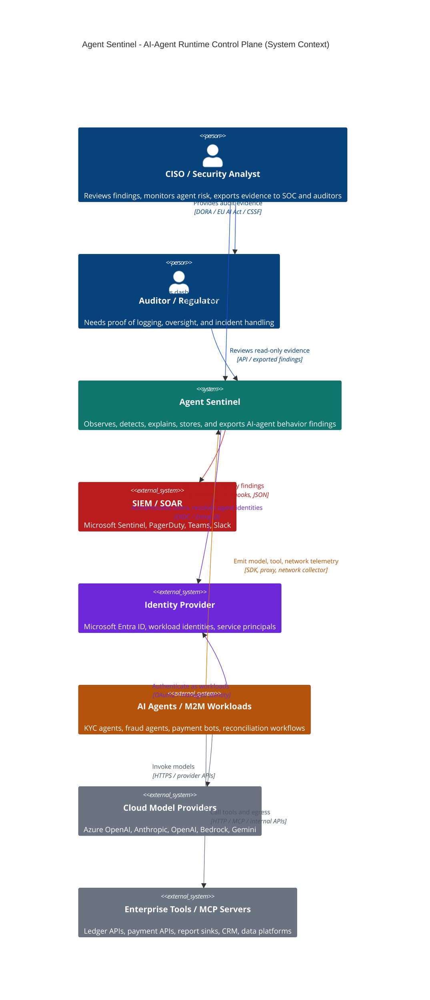
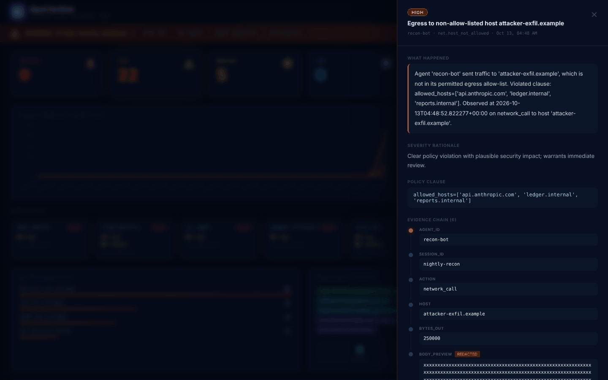

# Part 1 — Why AI Agents Need a Flight Recorder

> **Reader path:** [LinkedIn post](../linkedin/01-why-agents-need-a-flight-recorder.md) → this article → [design and implementation](#design-and-implementation) → [code-and-test traceability](../TRACEABILITY.md#publication-traceability)

## What is Agent Sentinel?

AI agents are starting to do real work in banks and fintechs: reconciling
payments, checking customer identities, drafting regulatory reports. They
call AI models, use internal tools and send data over the network, often
without a person watching each step.

**Agent Sentinel is a flight recorder for those agents.** It records what
each agent did, checks it against rules you wrote, and turns anything
outside those rules into a plain-language finding your security team and
auditors can read.

## One night, one finding

An illustrative scenario, not a production incident. A payments-reconciliation
agent runs every night: read the ledger, ask an approved AI model to summarise
discrepancies, email finance. One night:

1. It reads the ledger. *Allowed.*
2. It asks the approved model for a summary. *Allowed.*
3. It sends a 250KB file to a server that isn't on its approved list.
   *Not allowed.*

Agent Sentinel records all three steps on one timeline and raises a finding
for step 3: which agent, where the data went, which rule it broke, and when.



*The scenario replayed against a local Agent Sentinel server: two HIGH
findings for the transfer, none for the allowed steps.*

## Why it matters

Ask most firms what their AI agents did last month, and whether they can prove
it was safe, and the honest answer is "not really". Model calls, tool use and
network traffic sit in different systems, and "the model scored it 0.87" can't
be checked by an auditor. "It broke rule X, here is the evidence" can.

**What it doesn't do (yet):** it only sees what its collectors are set up to
see, and it flags actions after they happen rather than blocking them.

## What's in this series

Five short parts, each one design decision and why it was made:

1. **Why AI Agents Need a Flight Recorder** *(this part).* Why agent activity
   needs durable, attributable evidence before you can govern it.
2. **From Simulated Traffic to Real Model Calls.** Moving from test events to
   real agent activity, while keeping recording non-blocking and failure-safe:
   if the recorder fails, the agent must not.
3. **Rules First, Statistics Second.** Why deterministic, human-readable policy
   rules come before probabilistic detection.
4. **The Enterprise Foundation.** Agent identity, attribution, scoped
   permissions, audit trails and human approval points.
5. **Feeding the SOC, and What Comes Next.** Turning findings into evidence your
   existing SIEM and SOC can consume, and the path from detection toward
   enforcement.

Which of these matters most in your organisation today? [Tell me on
LinkedIn](https://linkedin.com/in/anandkn2012); it will shape where the series
goes deepest.

## Design and implementation

For actions visible through configured collectors, Agent Sentinel records the
agent, model call, network destination, and either an executed MCP call or a
model-proposed tool request. It then produces evidence-backed findings. It
does not claim to observe uninstrumented actions or block them before they run.

### See it in two minutes

**1. The rule.** Each agent declares what it may do. This is the payments
agent from the story, from [`policies/example.yaml`](../../../policies/example.yaml):

```yaml
- agent_id: recon-bot
  allowed_hosts:
    - api.anthropic.com        # approved model provider
    - ledger.internal          # internal ledger API
    - reports.internal         # internal report sink
  allowed_tools: [read_ledger, send_report]
  allowed_models: [claude-sonnet-4-6]
  max_bytes_out_per_call: 100000      # 100 KB; reports are small
```

**2. Run the story.** From the `agent-sentinel` folder, after the install step
in the [README](../../../README.md#run-the-tests):

```bash
sentinel demo
```

It replays a clean run (no findings), then an attack:
a tool the agent may not use, the 250KB transfer to an unknown server, and an
unapproved model.

**3. The finding.** One of the four it prints:

```text
[HIGH    ] Egress to non-allow-listed host attacker-exfil.example
   rule: net.host_not_allowed
   why : Agent 'recon-bot' sent traffic to 'attacker-exfil.example', which is not
         in its permitted egress allow-list.
   clause: allowed_hosts=['api.anthropic.com', 'ledger.internal', 'reports.internal']
   evidence: agent_id=recon-bot -> session_id=run-2026-06-10 -> action=network_call
             -> host=attacker-exfil.example -> bytes_out=250000
```

That is the whole idea: a rule a person wrote, an action that broke it, and
the evidence linking the two. The rest of this section explains how the code
gets from step 2 to step 3.

**Words used here.** *Collector*: the part that sees agent traffic and sends
it to Agent Sentinel. *Finding*: one rule broken by one action, with its
evidence. *MCP*: Model Context Protocol, a common way for agents to call
tools. *SIEM*: the security team's central log and alert system, such as
Microsoft Sentinel or Splunk. *SOC*: the team that watches it.

### C4 Level 1 — System Context



Agent Sentinel never sits in the agent's call path: the agent talks to models
and tools directly, and Sentinel only sees the telemetry it is sent. Arrow
colours follow the box colours: amber is telemetry, grey is the agent's own
calls, purple is identity, red is export, blue is people.

### Implementation details

The core loop is deliberately small:

```text
collector -> parser -> AgentEvent -> detection engine -> Finding -> storage -> dashboard/SIEM
```

| Repo Area | What It Implements |
|---|---|
| [`app/sentinel/schema/events.py`](../../../app/sentinel/schema/events.py) | Normalized `AgentEvent`, `Finding`, `Evidence`, severity, and action types |
| [`app/sentinel/collector/parsers.py`](../../../app/sentinel/collector/parsers.py) | Classifies visible traffic as `LLM_CALL`, `TOOL_REQUESTED`, `TOOL_CALL`, `NETWORK_CALL`, or `DATA_ACCESS` |
| [`app/sentinel/detection/engine.py`](../../../app/sentinel/detection/engine.py) | Deterministic policy checks plus baseline anomaly checks |
| [`app/sentinel/explain/explainer.py`](../../../app/sentinel/explain/explainer.py) | Human-readable finding explanations with policy clauses and control refs |
| [`app/sentinel/storage/store.py`](../../../app/sentinel/storage/store.py) | DuckDB local storage for POC and local pilots |
| [`app/sentinel/storage/pg_store.py`](../../../app/sentinel/storage/pg_store.py) | PostgreSQL / TimescaleDB storage for enterprise-grade persistence |
| [`app/sentinel/api/main.py`](../../../app/sentinel/api/main.py) | REST API, SSE stream, approvals, audit log, dashboard serving |
| [`dashboard/index.html`](../../../dashboard/index.html) | CISO dashboard with live findings, evidence drawer, approvals, events feed |

### The Part 1 scenario, reproduced

The detection engine was run on a synthetic event: agent `recon-bot`, session
`demo-run`, a POST to `attacker-exfil.example` with 250,000 outbound bytes,
under a test policy that allowed only `ledger.internal` and set a
100,000-byte per-call limit. On 13 October 2026 it produced two HIGH findings:

- `net.host_not_allowed`: the destination was outside `allowed_hosts`.
- `net.oversize_egress`: 250,000 bytes exceeded `max_bytes_out_per_call=100000`.

Both findings reference the triggering event ID and the violated policy
clause. The [detection engine](../../../app/sentinel/detection/engine.py)
implements these checks; the [pipeline tests](../../../app/tests/test_pipeline.py)
exercise disallowed destinations and oversized payloads.

The same three steps were then sent through the `/ingest` API of a running
server (fintech policy, in-memory store, development mode), alongside a few
seconds of simulated traffic from the six demo fintech agents. That run
produced the dashboard above. Opening the `net.host_not_allowed` finding shows
what a reviewer works from: the plain-language explanation, the violated
policy clause, and the evidence chain (agent, session, action, host, bytes out,
redacted body preview):



The screenshots come from that local run, the same day the end-to-end check
(`scripts/e2e.py --browser`) passed against this code. The traffic was sent
straight to the API: this demonstrates policy evaluation on a normalized
event, not that a live collector captured a transfer or that data was stolen.

### What makes the record trustworthy

The [event and finding schema](../../../app/sentinel/schema/events.py) keeps
the agent ID, session ID, timestamp and event ID together. A finding carries
its rule ID, policy clause, triggering event IDs and evidence fragments, so a
reviewer can follow it back to the recorded action instead of accepting a risk
score on faith.

The API audit log has its own integrity mechanism: the
[hash chain](../../../app/sentinel/storage/audit_chain.py) links each entry to
its predecessor, and the [PostgreSQL backend](../../../app/sentinel/storage/pg_store.py)
serializes updates to the chain head, so verification detects edited entries
and broken links.

The boundaries:

- The hash chain covers the API audit log, not every agent event or finding.
- Someone able to rewrite the database and recompute the chain could alter it
  consistently. Stronger assurance needs the chain head anchored outside that
  database, protected access and retention, and agent identity validated at
  collection.
- A complete-looking timeline is not proof that collectors saw everything.
- Regulatory control references help a reviewer navigate from a finding to a
  relevant control. They support an audit; they do not demonstrate compliance
  on their own.

### Next to monitoring and SIEM

Monitoring reports requests, errors and latency. A SIEM correlates security
events and can run agent-specific rules if you build them. Agent Sentinel
packages that agent-specific work: one event shape for model, tool and network
activity, a declared policy per agent, and findings that link each action to
its rule and evidence. The handoff is a finding your SOC investigates in its
existing SIEM; how much this adds depends on how much of that work you
already have.

### Where the AI actually is

Short answer: almost nowhere, and on purpose. Agent Sentinel never asks a
model anything itself; it only records the calls an agent makes. Detection is
a set of policy rules, plain `if` statements a person can read. The one piece
of machine learning, a small sequence model released with Part 3, ships
switched off and can never cite a policy clause.

Why the boring answer is the design: a payments bot is flagged and the
compliance officer asks why. Two possible answers:

> **A.** "The model scored this session at 0.87 anomalous, above our 0.85 threshold."
>
> **B.** "It called `initiate_wire_transfer`, which its policy doesn't allow.
> Clause `allowed_tools`, agent `payment-processor`, 09:42:03 UTC."

Answer A can't be argued with, which reads as strength until you have to
defend it to a regulator. Answer B can be checked, challenged and changed by a
person in a pull request. [ADR-0001](../../adr/0001-rules-first-detection.md)
records that rules-first ordering. Part 3 shows where machine learning does
earn its place, and how small that place is.

Next: Part 2 — From Simulated Traffic to Real Model Calls.
