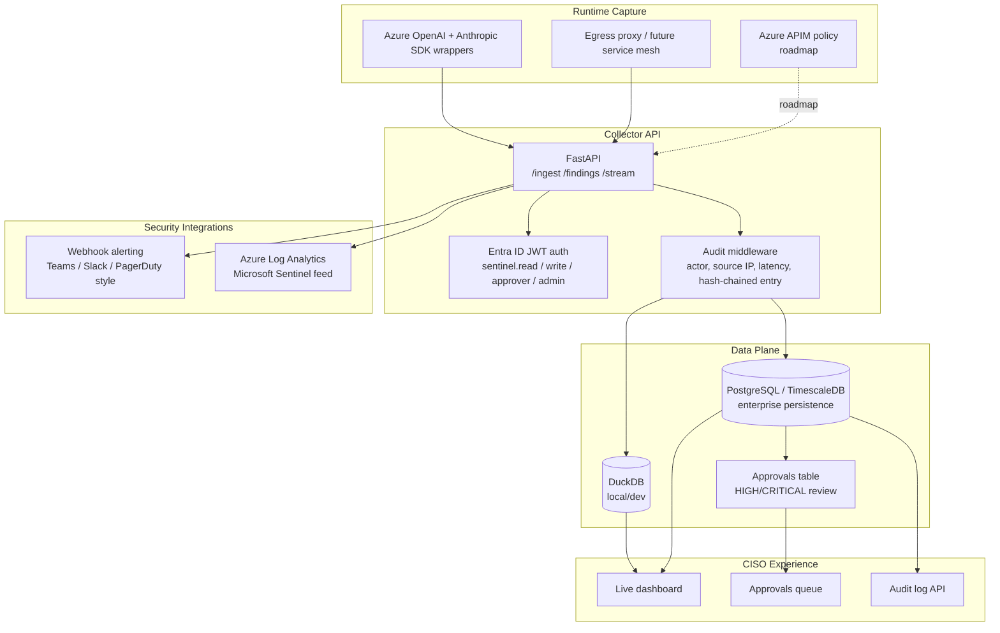

# Part 4 — The Enterprise Foundation

> **Reader path:** LinkedIn post → this article → [design and implementation](#design-and-implementation) → [code-and-test traceability](../TRACEABILITY.md#publication-traceability)

## The questions a security review asks first

The difference between a demo and a product a bank will run isn't prettier
charts. It's four questions a vendor security review asks before it asks
about features:

1. Who is allowed to call this system?
2. Where does the data live?
3. Who looked at what?
4. Does a risky finding wait for a human?

A tool that records what AI agents do holds sensitive evidence: which agent
touched which system, where data went, previews of prompts. If it can't
answer those four questions, it becomes the next thing the security team has
to worry about. This part is how Agent Sentinel answers them, and where the
answers stop.

## Who is allowed to call it

Every request to Agent Sentinel's API needs a token from Microsoft Entra ID,
the identity provider most regulated firms already run. The token is checked
for its signature, issuer and audience before anything else happens.

The important behaviour is what happens when sign-in *isn't* set up. Many
tools quietly open up when a setting is missing. Agent Sentinel refuses every
request instead. The only way to run without sign-in is to switch on a
developer mode explicitly, and the server logs a warning when you do.

Access is split into separate permissions, so no single role does
everything by accident:

- **Write:** collectors sending events in.
- **Read:** analysts reading findings and the live stream.
- **Approver:** compliance staff deciding on high-severity findings.
- **Admin:** reading and verifying the audit trail.

The collectors from [Part 2](../technical-details/02-from-simulated-traffic-to-real-model-calls.md)
sign their requests too. And Part 2's rule still holds: if a collector's
token is wrong, the agent carries on and the refused delivery is counted.
Recording fails open, so the agent isn't stopped. Access fails closed, so the
evidence isn't exposed.

## Who owns the agent

Sign-in answers who may call Agent Sentinel. It doesn't answer who owns the
agent being recorded.

Agent Sentinel takes the agent's name from the event a collector sends. A
collector's token can be limited to the agents it may report for, and every
event is stamped with the identity that actually sent it. An agent with no
policy entry is itself a finding, raised before it does anything wrong.

What Agent Sentinel does not do is manage the agent's identity over time:
who is accountable for it, and whether it should still exist. That belongs in
the identity provider. Microsoft Entra Agent ID is adding this, in preview as
I write: a named sponsor for each agent identity, and clean-up of identities
that go unused.

The two fit together as three questions. Should this agent still exist? The
identity provider. What may it do? Its policy. What did it do? The record. An
agent whose identity has been disabled should have no policy entry here, and
keeping those two lists in step is a manual job today.

## Where the data lives

Agent Sentinel runs where you deploy it. On a laptop it keeps events and
findings in a local DuckDB file. Set one connection string and it uses
PostgreSQL instead, the kind of database a platform team can back up,
replicate and restrict. Nothing leaves your environment unless you configure
an export, which is the subject of Part 5.

## Who looked at what

Every call to a protected endpoint is written to an audit trail: who made it
(taken from their sign-in), from which address, what they asked for, a hash
of what they sent, the result and how long it took.

On PostgreSQL each audit entry also carries a fingerprint of the entry before
it, forming a hash chain. Edit or delete an old entry and the chain breaks;
a verify endpoint names the first broken link.

That protection has a limit, and it should be said plainly. The chain lives in
the same database it protects. Someone with full control of that database
could rewrite every entry after the one they changed and rebuild the chain.
Anchoring the chain somewhere they can't reach is on the roadmap. The local
DuckDB mode keeps no audit chain at all.

## A risky finding waits for a human

On PostgreSQL, every high- or critical-severity finding opens an approval
automatically. A signed-in reviewer with the approver permission records one
of three decisions: approve it as reviewed, escalate it to incident response,
or suppress it as a known false positive, with a comment explaining why.

An early version had a free-text "reviewer" field: the caller typed in whose
decision it was. That is a signature anyone can forge. Now the reviewer is
always the person whose sign-in made the request, and the request body can't
name anyone else.

An approval is a decision about a *finding*. It doesn't pause the agent: as
in every part so far, Agent Sentinel records and explains, and doesn't block.

## What isn't done yet

A roadmap you can point to is more credible than a feature list that implies
everything is solved:

- **Dashboard sign-in.** The built-in dashboard can't sign users in yet. Treat
  it as a local tool, or put it behind a gateway that handles sign-in.
- **Team isolation.** One deployment serves one team; there is no separation
  between teams or environments inside it.
- **Identity lifecycle link.** Nothing checks an agent's policy entry against
  the identity provider, so a disabled agent can keep its policy.
- **Policy workflow.** Policies are YAML files. Fine for a pilot; many teams
  need review, approval and version history.
- **Tamper evidence outside the database**, as above.
- **High availability.** It runs as a single server today.

## The trade-off

Every control here makes Agent Sentinel harder to try. Refusing to run
without sign-in, for example, means a first-time user hits an error before
they see a dashboard. I chose that friction deliberately: a tool that holds
evidence about regulated systems should be awkward to run carelessly, not
easy to run unsafely.

Next: [Part 5 — Feeding the SOC, and What Comes Next](05-feeding-the-soc-and-what-comes-next.md).

What's the one control you'd never skip, even under deadline pressure?
[Tell me on LinkedIn](https://linkedin.com/in/anandkn2012).

## Design and implementation

This is what turns the pilot into something a regulated security team can evaluate seriously.

### Enterprise architecture

| Capability | Current Repo Implementation | Notes |
|---|---|---|
| Auth | [`app/sentinel/api/auth.py`](../../../app/sentinel/api/auth.py) | Entra ID JWT validation when configured; otherwise fails closed unless `SENTINEL_DEV_MODE=1` is explicitly set |
| Collector auth | [`app/sentinel/collector/sdk_base.py`](../../../app/sentinel/collector/sdk_base.py) | SDK reporter accepts a bearer token or token provider |
| Audit trail | [`app/sentinel/api/audit.py`](../../../app/sentinel/api/audit.py), [`audit_chain.py`](../../../app/sentinel/storage/audit_chain.py) | Captures protected endpoints including dynamic approval decisions. On PostgreSQL each entry is hash-chained to the previous one and `GET /audit-log/verify` names the first broken link; DuckDB keeps no audit chain (the endpoint returns 501) |
| PostgreSQL / TimescaleDB | [`app/sentinel/storage/pg_store.py`](../../../app/sentinel/storage/pg_store.py) | Activated through `DATABASE_URL`; falls back to DuckDB when absent |
| Approval workflow | `/approvals`, `/approvals/{id}` | Auto-created for high/critical findings in Postgres backend |
| SSE live stream | `/stream` | Pushes stats, findings, events, pending approvals every 1.5 seconds |
| Webhook alerting | [`app/sentinel/alerting/webhook.py`](../../../app/sentinel/alerting/webhook.py) | Sends high-signal findings to webhook targets |
| Log Analytics export | [`app/sentinel/siem/log_analytics.py`](../../../app/sentinel/siem/log_analytics.py) | Pushes findings to Azure Monitor / Log Analytics |

### Enterprise gaps still open

| Gap | Why It Matters | Roadmap Direction |
|---|---|---|
| Multi-tenancy | Enterprises need org/team/env isolation | Add `tenant_id`, `org_id`, `environment` across schema and policy |
| Policy lifecycle | YAML files do not scale to many teams | Policy API, GitOps sync, approvals, version history |
| Queue-backed ingestion | Direct HTTP can struggle during bursts | Azure Event Hub or Kafka with replay and DLQ |
| Key management | Env vars are not enough for regulated deployment | Azure Key Vault, managed identity, customer-managed keys |
| HA deployment | Single-node is not production enough | Azure Container Apps/AKS, horizontal replicas, health probes |
| Browser authentication | Built-in dashboard does not acquire/refresh Entra tokens | Add OIDC login and authenticated fetch/stream client |
| Tamper evidence | The hash chain lives in the same database it protects, so someone who can rewrite every later row can rebuild it | Export the chain head to append-only storage (WORM bucket, Log Analytics archive) or a signing service |

Approval decisions derive `reviewer` from the verified principal's `user_id`;
the caller cannot nominate a different reviewer in the request body. The
current dashboard is therefore a local/dev UI unless it is placed behind an
auth-aware gateway or replaced with the planned OIDC-capable client.
