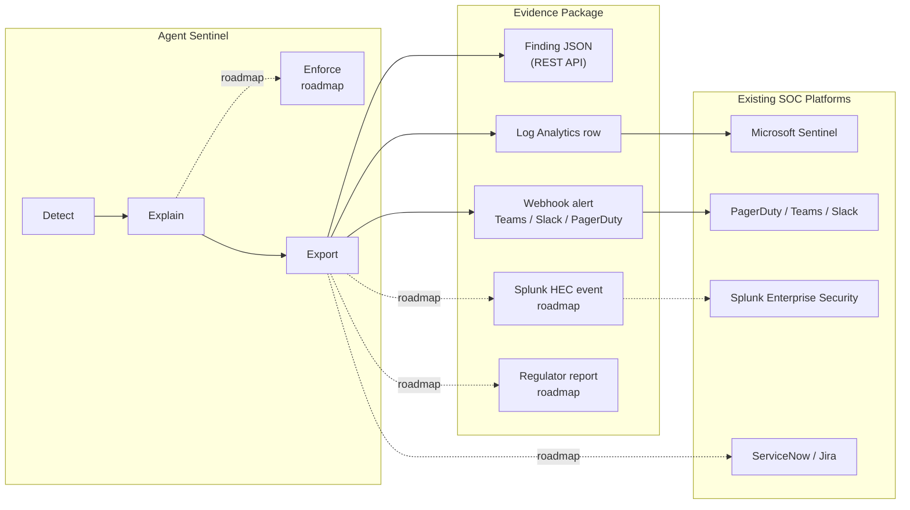
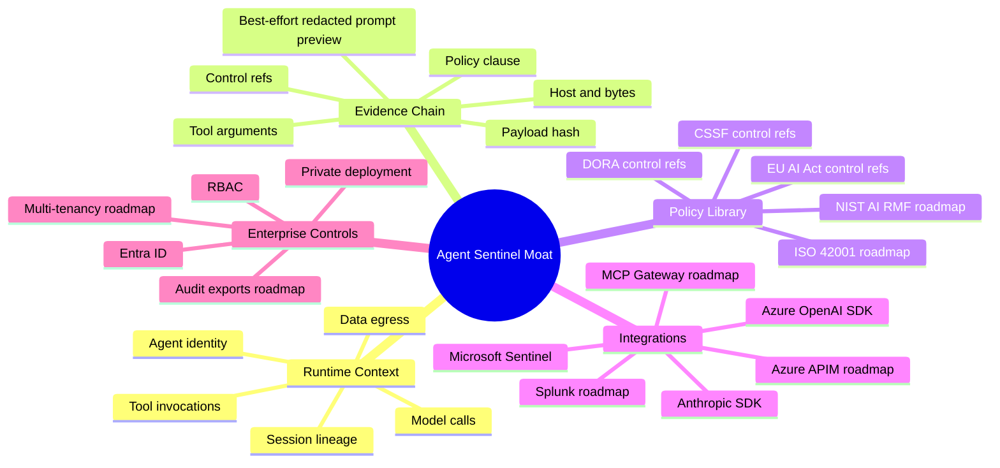

# Part 5 — Feeding the SOC, and What Comes Next


> **Reader path:** [LinkedIn post](../linkedin/05-feeding-the-soc-and-what-comes-next.md) → this article → [design and implementation](#design-and-implementation) → [code-and-test traceability](../TRACEABILITY.md#publication-traceability)

## Agent Sentinel should not be another SIEM

Every security team I'd want to work with already runs Microsoft Sentinel or
Splunk. They have analysts who know it, playbooks built on it and an incident
process around it. The last thing they need is another console to watch.

What they don't have is evidence about what an AI agent actually did: which
agent, which model, which tool, where the data went, and whether any of it
was allowed. A SIEM sees an HTTPS connection from a server. It doesn't know
that the server is a payments agent, that the destination isn't on that
agent's list, or which policy clause that breaks.

So Agent Sentinel's job ends where the SOC's job begins. Detect it. Explain it
in plain language. Export it into the tools the team already trusts.

## What arrives in the SOC

Take the night from [Part 1](../technical-details/01-why-agents-need-a-flight-recorder.md):
the reconciliation agent sends 250KB to a host nobody approved. Each finding
goes to Azure Log Analytics, which feeds Microsoft Sentinel, as one row.
Abridged:

```json
{
  "AgentId": "recon-bot",
  "RuleId": "net.host_not_allowed",
  "Severity": "high",
  "Title": "Egress to non-allow-listed host attacker-exfil.example",
  "Explanation": "Agent 'recon-bot' sent traffic to 'attacker-exfil.example', which is not in its permitted egress allow-list.",
  "PolicyClause": "allowed_hosts=['api.anthropic.com', 'ledger.internal', 'reports.internal']",
  "ControlRefs": "[\"DORA Art.10 (anomaly detection)\", ...]",
  "EvidenceFP": "sha256 of the evidence chain",
  "FindingUrl": "link back to the finding"
}
```

The analyst doesn't have to reconstruct anything. The row names the agent,
the rule, the clause it broke and the evidence, and links back to the full
finding. The control references point a reviewer to the regulatory controls
the policy author mapped the rule to. They are a starting point for the
reviewer, not a claim of compliance.

High-severity findings can also go straight to Microsoft Teams, Slack or
PagerDuty as alerts, carrying the same explanation and a fingerprint of the
evidence.

## Exporting without breaking the recorder

[Part 2](../technical-details/02-from-simulated-traffic-to-real-model-calls.md)'s
rule applies here as well: if an export fails, recording doesn't. Each
finding is stored first and exported second. If Log Analytics or a webhook
is down, the finding is still in Agent Sentinel and the failed delivery is
counted, so a gap in the SOC's feed can itself raise an alert.

## What Agent Sentinel adds, and what it doesn't

The SIEM stays better at what it already does: collecting logs from
everything, correlating incidents and running response playbooks. Agent
Sentinel adds the part it doesn't have natively:

- **An event model for agents.** Model calls, tool use and network traffic
  from the same agent, on one timeline.
- **Policy as code for each agent.** What it may do, in a file a person can
  read and review.
- **Findings that explain themselves.** The rule, the clause and the evidence,
  rather than a score.

Not an AI SIEM. The AI-agent evidence layer that feeds the SIEM you already
run.

## What comes next

Everything in this series records and explains *after* an action has
happened. It doesn't block anything, and I've tried to say that in every
part. Here is the path from detection toward enforcement, in the order I
expect to take it:

1. **More places to send evidence.** Splunk, ready-made Microsoft Sentinel
   analytic rules and workbooks, and tickets for escalated approvals.
2. **Stronger evidence.** Anchoring the audit chain outside the database
   ([Part 4](../technical-details/04-enterprise-foundation.md)'s open gap),
   and evidence bundles a reviewer or regulator can take away.
3. **Enforcement, as a separate component.** A gateway that sits *in* the
   agent's path, so it can stop an action before it happens. It needs its own
   design review and its own failure rule, because a recorder can afford to
   miss an event and a gateway can't afford to guess. It will start with the
   actions the evidence shows are safe to block, and with rules, not
   statistics, deciding what is blocked.

That order is deliberate. You can't safely block what you can't yet explain,
and you can't explain what you never recorded.

Blocking in the agent's path is no longer unusual. AI gateways and guardrail
services such as Azure API Management's AI gateway, Azure AI Content Safety
Prompt Shields and Amazon Bedrock Guardrails are now common, and they are worth
running. They answer a different question, though: they judge the content of
one request, often with a classifier score. This series judges an agent's
actions against the policy written for that agent, with a clause and the
evidence. A gateway that blocks without a record of what it blocked, and why,
is the unexplained score from
[Part 3](../technical-details/03-rules-first-statistics-second.md) again.
So the order holds: record and explain first, block what the record shows is
safe to block, and keep recording what the gateway decides.

## The series in five decisions

1. **Record first, block later.** Evidence comes before enforcement.
2. **If the recorder fails, the agent must not.** Fail open, but never
   silently.
3. **Rules decide; statistics advise.** A finding an auditor can check beats
   a score nobody can argue with.
4. **Fail closed on access.** The evidence is sensitive, so the system that
   holds it starts locked.
5. **Feed the SOC, don't replace it.** Agent-specific evidence, delivered into
   the tools the team already uses.

## Season 2

Three follow-up parts test those decisions harder: what the recorder
catches when an agent is prompt-injected, the data platform underneath it,
and what a finding does and does not evidence under DORA.

Next: Part 6 — Prompt Injection: What the Recorder Catches and What It Misses.

What AI-agent evidence do you most wish showed up in your SOC today?
[Tell me on LinkedIn](https://linkedin.com/in/anandkn2012).

## Design and implementation

Microsoft Sentinel and Splunk already do SIEM/SOAR well. Agent Sentinel should export high-fidelity AI-agent findings into them.

### SOC integration architecture



Solid arrows are implemented; dashed arrows are roadmap.

| Integration | Status | Implementation Direction |
|---|---|---|
| Azure Log Analytics | Implemented foundation | [`app/sentinel/siem/log_analytics.py`](../../../app/sentinel/siem/log_analytics.py) |
| Webhook alerting | Implemented foundation | [`app/sentinel/alerting/webhook.py`](../../../app/sentinel/alerting/webhook.py) |
| Microsoft Sentinel workbook | Roadmap | KQL workbook over custom Agent Sentinel table |
| Microsoft Sentinel analytic rules | Roadmap | Rules for critical agent egress, forbidden tool, shadow model |
| Splunk HEC | Roadmap | HTTP Event Collector JSON events |
| Splunk ES app | Roadmap | Notable events, dashboards, investigation workflow |
| ServiceNow / Jira | Roadmap | Ticket creation for escalated approvals |
| Evidence PDF export | Roadmap | Regulator-ready bundle with hash chain |

| Capability | Sentinel / Splunk | Agent Sentinel |
|---|---|---|
| Enterprise log ingestion | Excellent | Feeds enriched AI-agent events into them |
| Incident correlation | Excellent | Provides high-fidelity AI-agent findings |
| SOAR playbooks | Excellent | Triggers them |
| LLM prompt/tool context | Generic unless custom-built | First-class event schema |
| Pre-call enforcement | Limited without custom gateway | Product direction |
| Agent policy-as-code | Not native | Core product feature |
| Evidence chain for AI actions | Custom content | First-class artifact |
| DORA / EU AI Act supporting artifacts | Custom reporting | Control references and evidence fields; applicability still requires legal/scoping analysis |

In short: Agent Sentinel is not an AI SIEM. It is the AI-agent evidence layer
that feeds the SIEM you already run.

### Product direction: open core and the moat

This section is direction, not a product offer: today there is one open-source
codebase, the one in this repository. The mindmap shows where the value sits;
the tables in this series say which parts are built.



| Area | Open source (this repo) | A possible enterprise edition |
|---|---|---|
| SDK wrappers | Yes | Supported/certified versions |
| Event schema | Yes | Version governance and migration tooling |
| Local collector | Yes | HA collector fleet |
| YAML rules | Yes | Policy workflow, approvals, GitOps |
| DuckDB storage | Yes | Postgres/ClickHouse/Event Hub |
| Dashboard | Yes | RBAC, tenancy, executive reporting |
| SIEM export | Log Analytics and webhooks | Certified Sentinel/Splunk apps |
| Compliance mappings | Starter pack | Regulated industry packs and evidence exports |
| Enforcement | Observe/detect | APIM/proxy/block/quarantine are roadmap |

### POC to enterprise grade — the whole arc

| Dimension | Phase 1 POC | Phase 2 Real Pilot | Phase 3 Enterprise Foundation |
|---|---|---|---|
| Ingestion | Simulated HTTP events | Azure/Anthropic SDK wrappers | SDK + proxy + auth + audit |
| Models | Simulated/provider-parsed | Azure OpenAI and Anthropic | Multi-provider governance |
| Storage | DuckDB | DuckDB file or local DB | PostgreSQL / TimescaleDB |
| Detection | YAML rules + baseline | Same engine on real calls | Versioned policy service |
| UX | Local CISO dashboard | Live SSE dashboard | Protected APIs + approvals; OIDC dashboard client is roadmap |
| Identity | Manual `agent_id` | SDK-provided identity | Entra ID and workload identity |
| Enforcement | Observe | Observe (warn is roadmap) | Block/quarantine roadmap |
| Compliance | Control refs | Real-call evidence | Audit log + approvals |
| Deployment | Local process | Local process against real providers | Azure Container Apps / AKS roadmap |
| Product Readiness | Demo | Pilot | Enterprise beta foundation |

#### Regulatory scope note

The `control_refs` field helps reviewers navigate to relevant controls; it does
not certify compliance. DORA Articles 18 and 19 concern incident
classification and reporting, Article 25 concerns operational-resilience
testing, and Article 45 concerns cyber-threat information sharing. EU AI Act
Article 12 is framed for high-risk AI systems in scope. Luxembourg entities
must also account for the post-DORA amendments and scope changes to CSSF
Circulars 20/750 and 22/806, including Circular 25/882 for DORA entities' ICT
third-party services. See the [official-source links in the traceability
matrix](../TRACEABILITY.md#regulatory-scope).
