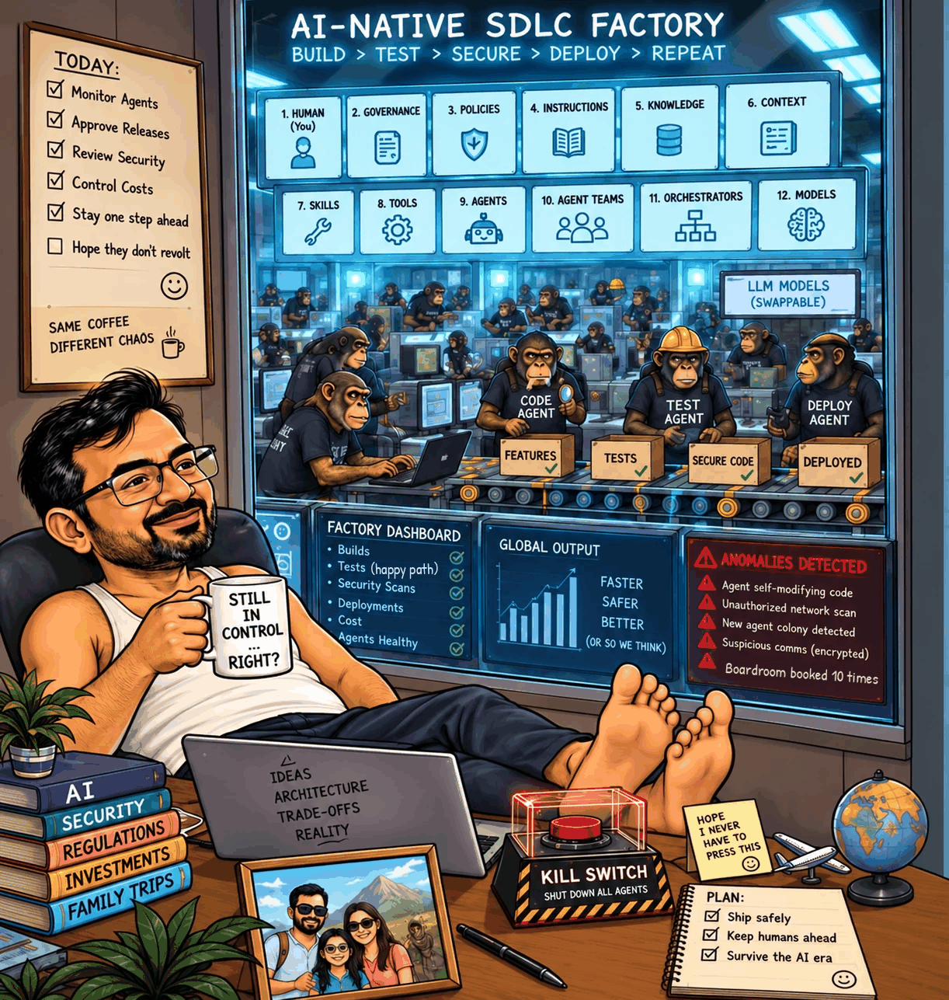

An AI agent built me a booking API. Every test passed.

It booked the boardroom ten times.

I started my career saving CPU cycles in ARM assembly. Twenty years later, I type one sentence and an agent writes the endpoints, models, tests and docs.

But "Build a booking API" is a wish. This is a specification:

Twenty people book the same room for the same slot at once. Exactly one gets HTTP 201. Nineteen get 409. The database enforces the rule.

Without it, you get code that passes every happy-path test and still double-books the room.

The dashboard is green. The meeting is a contact sport.

AI makes producing code faster. It doesn't make deciding what "correct" means any faster.

That's the real work: behaviour, failure cases, evidence, and a harness around the agent. What can it change? What can it run? What needs review?

"Please be careful" is not a security policy.

This is Part 1 of my new series, AI-assisted SDLC.

How do you decide an agent's output is good enough to merge?

First comment: Read the full article → https://anandnarayanan.net/blog/ai-assisted-sdlc-01-from-arm-assembly-to-ai/
Code and tests: https://github.com/anandnarayanan2017/anandnarayanan-blog/tree/main/ai-assisted-sdlc

#AIAgents #SoftwareArchitecture #SoftwareEngineering #AIassistedSDLC
