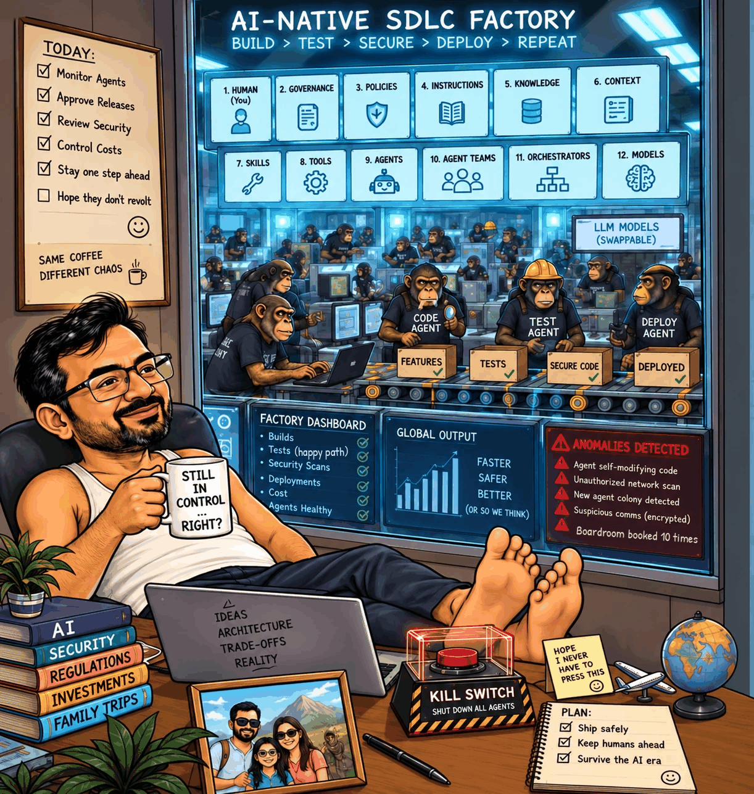

# From ARM Assembly to AI: Twenty Years of Explaining Myself to Computers

*All checks green. Every anomaly red. Spot the problem.*

I started my career writing C and ARM assembly to optimise codecs.

Back then, I would study a loop, examine memory access, and rearrange instructions to save a few CPU cycles.

A small performance improvement could make my day.

Today, my browser uses more memory to display a meeting invitation than some of those systems had available.

I try not to take it personally.

Then I moved into Java enterprise development.

Memory management became somebody else’s responsibility. In return, I met factories, interfaces, dependency injection, and stack traces with enough material for a weekend reading plan.

In assembly, I knew which register held my value.

In enterprise Java, I sometimes needed three people to explain which service owned it.

The abstraction had moved up a layer. My job hadn’t: know where things live, and what happens when they break.

Eventually, I became an architect.

I drew boxes and connected them with arrows.

The boxes had impressive names. The arrows looked simple.

Those arrows contained authentication, retries, timeouts, network failures, and the small question of what happened if the money left one system but never arrived in the other.

Experience taught me to spend more time asking about the arrows.

Then came the cloud.

Infrastructure became code. Environments could be created in minutes. Scaling became much easier.

So did accidentally leaving something expensive running.

I had progressed from asking, “Why does this take so many cycles?” to “Why does this subscription have seventeen databases?”

And now, AI.

I can type:

“Build a booking API.”

An agent produces endpoints, database models, tests, and documentation.

For a moment, I wonder whether twenty years of engineering was an elaborate training programme for typing one sentence.

Then I review the result.

Right. Still work to do.

**“Build a booking API” is a wish.**

Here is an illustrative specification:

> Twenty people try to book the same room for the same time slot simultaneously. Exactly one request succeeds with HTTP 201. The other nineteen receive HTTP 409. The database enforces the rule.

Now we have something we can design and test.

Without that detail, you can end up with an implementation that passes every happy-path test and books the boardroom ten times.

The dashboard is green.

The meeting is a contact sport.

This is what interests me about AI-assisted development: how much engineering work goes into making a task clear enough to delegate and a result reliable enough to accept.

We need to define behaviour, constraints, failure cases, and the evidence that will convince us it works.

We also need a harness: the context, tools, permissions, and checks surrounding the agent.

Which files can it change? Which commands can it run? What requires review? What happens when a check fails?

“Please be careful” remains a charming security policy.

That thinking is behind my **AI-assisted SDLC project**: exploring how intent, specifications, and a structured development workflow can guide AI-assisted implementation.

After twenty years, I find myself using old lessons in a new setting.

Measure the result. Question assumptions. Check failure paths. Understand the arrows.

AI makes producing code faster. It doesn’t make deciding what ‘correct’ means any faster.

I began by writing instructions for an ARM processor.

Now I write instructions for an agent that writes instructions for a processor.

More layers. Same question:

**How do we know it works?**

[Follow the series on GitHub](https://github.com/anandnarayanan2017/anandnarayanan-blog/tree/main/ai-assisted-sdlc)

## References and further reading

- **The booking specification, as code:** [examples/double-booking](https://github.com/anandnarayanan2017/anandnarayanan-blog/tree/main/ai-assisted-sdlc/examples/double-booking). The twenty-request test, the check-then-insert attempt an AI agent wrote first (it booked the room ten times), and the database constraint that fixed it. Runs in CI on every change.
- **Specifications over wishes:** David Thomas and Andrew Hunt, *The Pragmatic Programmer*, 20th Anniversary Edition (Addison-Wesley, 2019). Its point that no one knows exactly what they want is why “Build a booking API” needs a specification.
- **The arrows:** [The fallacies of distributed computing](https://en.wikipedia.org/wiki/Fallacies_of_distributed_computing), attributed to L Peter Deutsch and colleagues at Sun Microsystems. The network is not reliable, latency is not zero, and so on.
- **Booking the boardroom ten times:** Martin Kleppmann, *Designing Data-Intensive Applications* (O’Reilly), chapter on transactions. It uses a meeting-room booking system to explain write skew and why the rule belongs in the database.
- **Letting the database enforce it:** PostgreSQL documentation, [Exclusion constraints](https://www.postgresql.org/docs/current/ddl-constraints.html#DDL-CONSTRAINTS-EXCLUSION), which reject overlapping bookings for the same room.
- **201 and 409:** [RFC 9110, HTTP Semantics](https://www.rfc-editor.org/rfc/rfc9110), sections 15.3.2 (201 Created) and 15.5.10 (409 Conflict).
- **Agents and harnesses:** Anthropic, [Building effective agents](https://www.anthropic.com/engineering/building-effective-agents) and [Effective harnesses for long-running agents](https://www.anthropic.com/engineering/effective-harnesses-for-long-running-agents).
- **Engineering discipline for agents:** Matt Pocock, [Skills for real engineers](https://github.com/mattpocock/skills), agent skills grounded in classic software engineering practice.

## Acknowledgements

Thanks to Claude by Anthropic, which I used as a reviewer and editor while writing this post. The ideas, opinions and any mistakes are my own.
